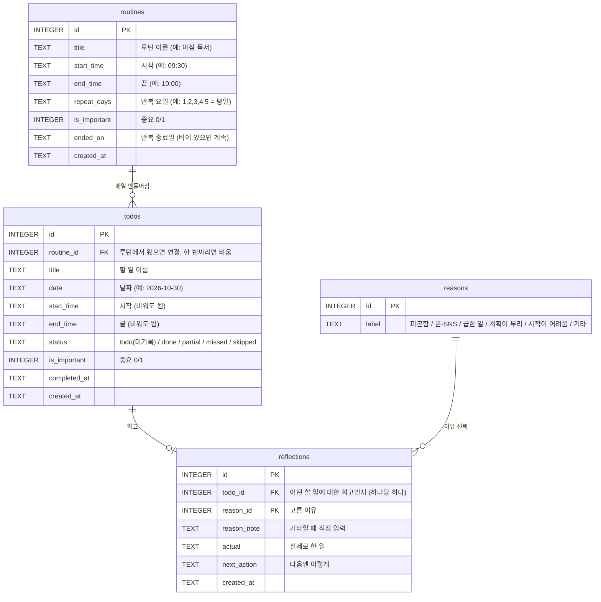

# DB 구조 — 루틴 플래너

로컬 무료 DB: **SQLite** (`todo.db` 파일 하나)

## 구조도



## 표 4개, 각자 하는 일

| 표 | 하는 일 | 한 줄 예시 |
|---|---|---|
| **routines** | 루틴의 원본(템플릿). 한 번 등록해 두는 것 | 아침 독서, 09:30~10:00, 평일, 중요 |
| **todos** | 특정 날짜의 실제 체크 항목. 루틴에서 자동으로 만들어지거나 직접 추가 | 2026-10-30 아침 독서 → 완료 |
| **reflections** | '일부만 / 못 함' 항목에 대한 회고 | 실제로: 유튜브 봄 / 이유: 폰·SNS / 다음엔: 폰 다른 방에 |
| **reasons** | 이유 선택지 목록 (나중에 '자주 나온 이유' 통계에 사용) | 폰·SNS |

## 관계

- **routines 1 : N todos** — 루틴 하나가 날마다 할 일을 하나씩 만든다. 한 번짜리 할 일은 `routine_id`가 비어 있다.
- **todos 1 : 0..1 reflections** — 할 일 하나에 회고는 없거나 하나.
- **reasons 1 : N reflections** — 같은 이유가 여러 회고에서 쓰인다.

## 설계하면서 정한 것들

1. **todos에 제목과 시간을 복사해 둔다.** 루틴을 고쳐도 지난 기록은 그대로 남고, 다음 날부터만 바뀐다. (PRD: "루틴을 수정하면 다음 날부터 반영")
2. **같은 루틴이 같은 날 두 번 생기지 않게** `todos`에 `(routine_id, date)` 중복 금지 규칙을 건다.
3. **'지난번 다음엔 이렇게'는 따로 표를 두지 않는다.** 같은 루틴의 가장 최근 회고를 찾아서 보여 주면 된다.
4. **중요 표시(`is_important`)는 루틴과 할 일 양쪽에** 둔다. 루틴이 중요하면 만들어지는 할 일도 중요로 시작하고, 하루 단위로 따로 바꿀 수도 있다.
5. **시간·날짜는 글자(TEXT)로** 저장한다(`2026-10-30`, `09:30`). SQLite에서 가장 단순하고, 글자 순서대로 정렬해도 시간 순서가 맞다.
6. **(구현하면서 추가) `status`에 `skipped`** — 루틴 항목을 '이 날만 빼기' 하면 다시 자동 생성되지 않도록, 행을 지우는 대신 `skipped`로 숨긴다. 한 번짜리 할 일은 실제로 지운다.
7. **(PRD 보완) 루틴은 지우지 않고 '반복 종료'** — `ended_on`에 종료일을 넣으면 그날까지만 생기고, 지난 기록과 회고는 루틴과 계속 연결된다.
8. **`status = 'todo'`는 화면에서 '미기록'**이다. 날짜가 지나도 자동으로 '못 함'으로 바꾸지 않는다.

## 이 구조로 쓰는 SELECT 예시

오늘 타임라인 (시간 순서):

```sql
SELECT title, start_time, end_time, status, is_important
FROM todos
WHERE date = '2026-10-30'
ORDER BY start_time;
```

'아침 독서' 루틴의 지난번 "다음엔 이렇게":

```sql
SELECT r.next_action
FROM reflections r
JOIN todos t ON r.todo_id = t.id
WHERE t.routine_id = 3
ORDER BY t.date DESC
LIMIT 1;
```

## 길 B(Supabase)로 옮길 때 바뀌는 점

- `routines`, `todos`, `reflections`에 **`user_id`(누구 것인지)** 열이 추가된다.
- RLS 규칙: `user_id = 로그인한 사용자`인 행만 조회·추가·수정·삭제할 수 있다.
- `reasons`는 모두가 같이 쓰는 선택지라 읽기만 허용한다.
