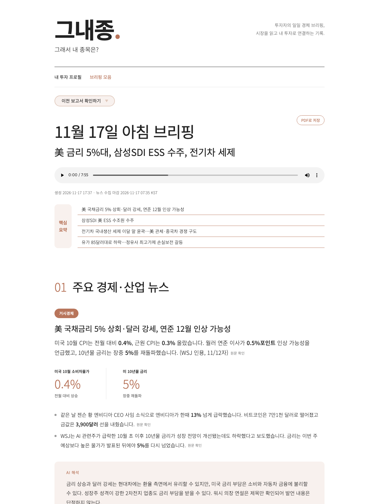
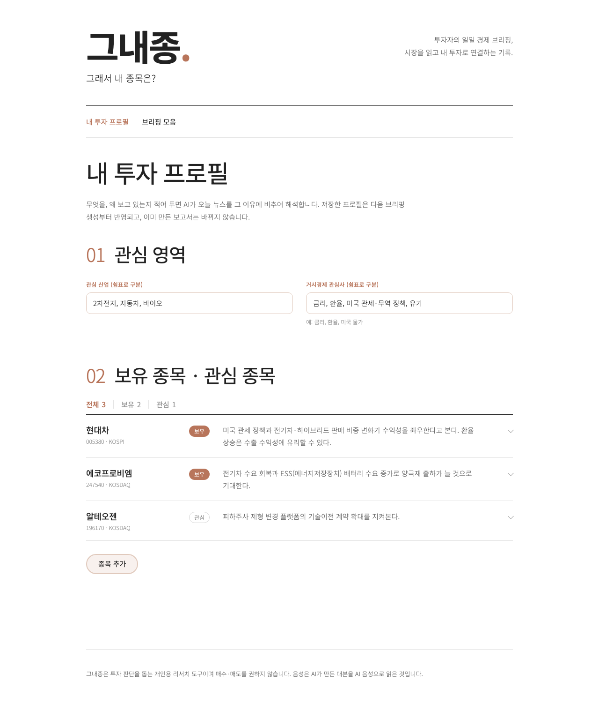
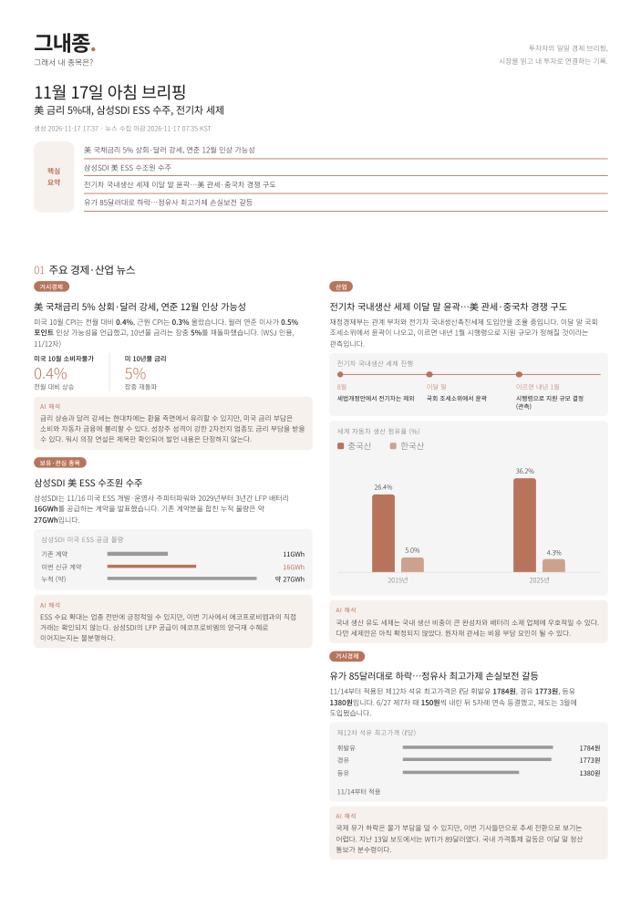
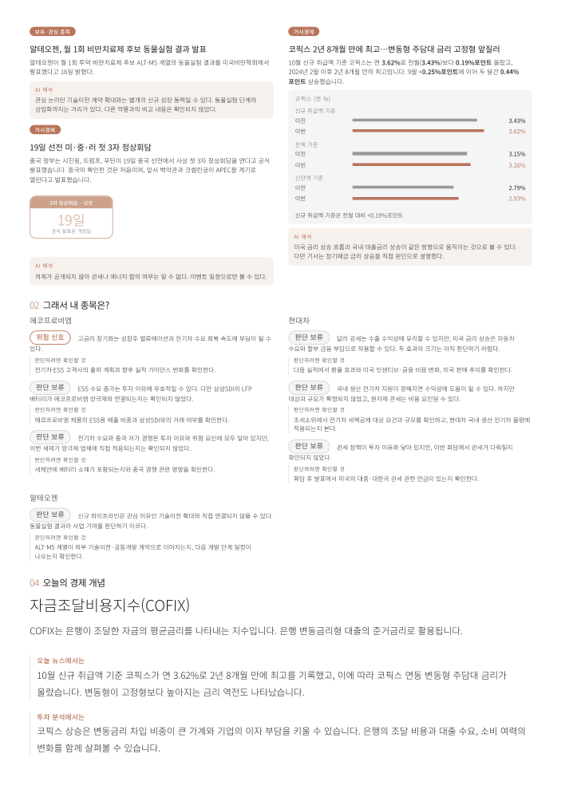

# 그내종. 그래서 내 종목은?

### ▶ [홈페이지 바로 가기](https://k-im-rose.github.io/geunaejong-demo/) · [코드 저장소](https://github.com/k-im-rose/aiffel/tree/investment-ai-briefing/investment-ai-briefing)

경제 뉴스를 듣고 "그래서 내 종목은?"까지 답해 주는 개인화 투자 리서치 서비스 PoC.
내 투자 이유를 등록하면 국내외 경제 뉴스 수백 건 중 필요한 소식만 골라, 아침에 들을 음성 브리핑과 날짜별 투자 리서치 보고서로 만들어 준다.
모두의연구소(MODULABS) AIFFEL AI 에이전트 과정 **Main Quest 02** "내 도메인에서 AI로 개선 지점 찾아서 PoC 만들기"로, 에이전트(Claude Code)와 함께 만들었다.

> 키워드 알림은 내 종목 이름이 들어간 기사만 보여 줘요.
> 내가 왜 이 종목을 갖고 있는지를 아는 AI가 골라 주면 어떨까, 에서 시작했어요.

- **홈페이지:** [k-im-rose.github.io/geunaejong-demo](https://k-im-rose.github.io/geunaejong-demo/) (설치·회원가입·API 키 없이 링크만 열면 된다. 첫 화면에서 **데모 체험하기**를 누른다)
- 배포용 정적 파일 저장소: [geunaejong-demo](https://github.com/k-im-rose/geunaejong-demo) · 만드는 스크립트: `scripts/build_static_demo.py`
- 문제 정의: [docs/problem_definition.md](docs/problem_definition.md) · 모델 선택: [docs/model_selection.md](docs/model_selection.md) · 실패 사례: [docs/failure_cases_demo.md](docs/failure_cases_demo.md)
- 비용 원칙: [docs/cost_principles.md](docs/cost_principles.md) · 제출 이후 계획: [docs/roadmap_post_poc.md](docs/roadmap_post_poc.md) · 로그인 설계: [docs/auth_design.md](docs/auth_design.md)

> ### 데모 환경 안내
> 본 프로젝트의 공개 데모는 개인정보 보호를 위해 **가상 투자자 프로필**을 사용합니다.
> - 보유·관심 종목 설정, 투자 이유, 관심 키워드 및 위험 요인은 데모용으로 구성된 **가상 데이터**입니다.
> - 뉴스는 **실제 수집된 뉴스**(2026-11-17)를 사용했습니다.
> - 뉴스 선별, 투자 관점 분석, 경제 개념 설명, 음성 대본 및 브리핑은 **실제 AI 파이프라인을 통해 생성한 결과물**입니다.
> - PoC 성능 평가 수치는 **실제 평가 과정에서 측정한 결과**입니다. 평가 원본은 비공개이고 이 문서에는 종목명을 뺀 집계 수치만 적었습니다.
> - 실제 개인 투자 프로필과 개인 기록은 공개 저장소에 포함하지 않았습니다.
> - 공개 데모는 **교육 및 비상업적 포트폴리오 목적**으로 운영합니다.
> - 음성은 가상 프로필 데모 브리핑만 공개했고, **edge-tts**(Microsoft Edge의 온라인 읽어주기 음성, 진행자 ko-KR-SunHiNeural·ko-KR-InJoonNeural)로 생성했습니다. 생성 음성의 저작권은 아직 세계적으로 불분명하다는 안내를 받았고, 비상업 이용이라 공개했습니다. 실제 프로필 기반 음성은 공개하지 않습니다.
> - 본 서비스는 투자 판단을 돕는 개인 리서치 도구이며 매수·매도를 권유하지 않습니다.
>
> **테스트용 종목 검색 목록과 실제 뉴스는 별개입니다.** 기업명 검색에 쓰는 실제 상장 종목 목록은 아직 내려받지 않았습니다. 저장소의 `tests/fixtures/symbols/`는 자동 테스트용으로 만든 소규모 목록이며 공식 목록이 아닙니다. 데모 화면의 뉴스와는 관계가 없습니다.

## 사용 방법

### 한눈에 보기

> **열기 → 데모 체험하기 → 오늘의 브리핑 읽기 → 내 종목 영향 확인 → 개념·퀴즈 → 메모·점검**

### 1. 들어가기

홈페이지를 열면 **로그인 화면**이 먼저 나와요.

- **정식 로그인은 준비 중**이에요. 이메일·비밀번호 칸과 로그인 버튼은 일부러 막아 두었고, 아무 값도 보내지 않아요. 가짜 로그인은 만들지 않았어요.
- 아래 **데모 체험하기**를 누르면 회원가입 없이 메인 화면으로 들어가요. 가상 투자자 프로필과 실제 뉴스로 만든 브리핑이 보여요.

### 2. 메인 화면

맨 위 두 메뉴는 **내 투자 프로필**과 **브리핑 모음**이에요. 로고(그내종.)를 누르면 메인으로 돌아와요.

| 메인에서 보이는 것 | 뜻 |
|---|---|
| TODAY'S BRIEFING | 가장 최근 보고서의 날짜, 제목, 핵심 뉴스 3개, 오디오 길이. **보고서 읽기**로 들어간다 |
| 내 투자 프로필 | 보유 종목, 관심 종목, 관심 산업 요약 |
| 지난 브리핑 | 날짜별 보고서 목록 |
| 아직 점검하지 않은 항목 | 내가 남긴 점검 항목 개수와 앞의 3개 |

### 3. 오늘의 브리핑 읽기

보고서는 위에서 아래로 읽어요. 맨 위 **이전 보고서 확인하기**를 누르면 다른 날짜의 보고서로 갈 수 있어요.

| 보고서에 있는 것 | 뜻 |
|---|---|
| 제목과 **핵심 요약** | 오늘의 핵심 뉴스 4개를 한 줄씩 |
| 음성 플레이어 | 두 진행자가 읽어 주는 브리핑 음성(약 8분). 재생 버튼을 눌러 들어 봐요 |
| **01 주요 경제·산업 뉴스** | 뉴스마다 확인된 사실(중요한 부분은 굵게), 핵심 수치, 일정, **AI 해석**, 출처 링크(원문 확인) |
| **02 그래서 내 종목은?** | 내 종목마다 오늘 뉴스가 내 투자 이유에 어떤 영향인지 |
| **03 추가로 보면 좋을 뉴스** | 방송에 담지 못했지만 볼 만한 기사와 요약 |
| **04 오늘의 경제 개념 · 05 오늘의 퀴즈** | 그날 뉴스에 나온 경제 용어 하나와 4지선다 퀴즈 하나 |
| 메모 · 다음에 점검할 것 | 날짜별 메모와 점검 목록 |

### 4. 내 종목 영향 보기 (02)

종목 이름이 한 줄로 나열된 **종목 목차**를 누르면 그 종목으로 이동해요. 위험 신호가 있는 종목에는 점이 찍혀요.

| 표시 | 뜻 |
|---|---|
| **긍정 신호** | 확인된 사실이 내 기존 투자 이유를 직접 뒷받침할 때 |
| **위험 신호** | 확인된 사실이 내 투자 논리를 약하게 하거나 구체적인 위험을 키울 때 |
| **판단 보류** | 긍정·부정이 섞여 있거나 종목과의 직접적인 연결 근거가 부족할 때. 위험하다는 뜻이 아니에요 |
| 관련 뉴스 \| 제목 | 누르면 같은 보고서의 해당 뉴스(01)로 이동 |
| 판단하려면 확인할 것 | 그 판단을 확정하려면 실제로 확인할 것 |
| 점검 리스트 | 종목별로 묶은 AI 추천 점검 항목. **내 목록에 추가**에 마우스를 올리면 점검 목록에 어떻게 들어가는지 예시가 떠요 |

### 5. 퀴즈 풀기

질문을 읽고 보기를 골라 **정답 확인**을 눌러요. 정답과 해설이 나와요. 결과는 저장되지 않아요.

### 6. 메모와 점검 목록

- **오늘의 메모:** 저장 버튼이 없어요. 쓰는 대로 저장되고 `저장 중…` `저장됨`이 작게 떠요. 날짜마다 메모 하나를 이어서 써요.
- **다음에 점검할 것:** 한 줄로 추가하고 체크로 완료해요. 항목 아래에 등록일(2026-11-18 같은 형식)이 보여요. 수정·삭제는 작은 버튼이에요. 완료한 항목은 접힌 목록에 모여요.

### 7. 내 투자 프로필

상단 메뉴 **내 투자 프로필**에서 봐요.

- **01 관심 영역:** 관심 산업과 거시경제 관심사를 쉼표로 적어요.
- **02 보유 종목 · 관심 종목:** 종목이 한 줄씩 접혀 있고(종목명, 코드·시장, 보유/관심, 투자 이유 요약), 눌러서 펼쳐 수정해요. 여러 종목을 동시에 펼칠 수 있어요.
  - 위쪽 `전체 · 보유 · 관심` 탭으로 골라 봐요. 탭을 바꿔도 쓰던 내용은 그대로예요.
  - **집중 분석:** 특히 깊게 보고 싶은 종목에 켜요. 접힌 목록에도 작은 표시가 떠요.
  - **추가 요청사항:** AI에게 특히 확인받고 싶은 내용을 쓰는 칸이에요. 필요할 때만 펼쳐요.
  - **이 종목 빼기:** 저장하기 전까지는 **되돌리기**가 돼요.
  - 고친 내용이 있으면 화면 아래에 저장 영역이 나타나요. 저장하지 않고 페이지를 나가려 하면 안내해요.

### 8. 브리핑 모음

가장 최근 보고서가 바로 열려요. 다른 날짜는 맨 위 **이전 보고서 확인하기**에서 골라요.

### 9. PDF로 저장

보고서 맨 위 오른쪽의 **PDF로 저장** 버튼을 누르면 인쇄 창이 열려요. 대상(프린터)을 **PDF로 저장**으로 고르면 끝이에요. 별도 프로그램이 필요 없고, 읽기 좋게 줄인 **A4 한두 쪽** 보고서가 나와요.

- **담기는 것:** 핵심 요약, 주요 경제·산업 뉴스(핵심 수치·그래프·AI 해석), 종목별 영향과 확인할 것, 오늘의 경제 개념
- **빠지는 것:** 음성 플레이어, 퀴즈, 메모·점검 목록, 출처 링크 목록처럼 화면에서만 쓰는 것들
- 예시 파일: [docs/samples/daily-report-2026-11-17.pdf](docs/samples/daily-report-2026-11-17.pdf) (데모 보고서를 이 방식으로 저장한 2쪽짜리 PDF)

### 알아 두세요

- **내가 고친 것은 내 브라우저에만 저장돼요.** 프로필·메모·점검 목록을 마음껏 고쳐 봐도 다른 방문자에게는 아무 영향이 없어요. 브라우저 기록을 지우면 사라져요.
- **음성은 비상업 시연용이에요.** 두 진행자 음성은 [edge-tts](https://github.com/rany2/edge-tts)(Microsoft Edge의 온라인 읽어주기 서비스를 부르는 라이브러리)로 만들었어요. 이 서비스의 약관에서 음성 재배포를 허용하거나 금지하는 조항은 찾지 못했어요(허용 여부는 불명확). 생성된 음성의 저작권은 아직 세계적으로 불분명한데, 상업적 이용이 아니면 큰 문제가 없다는 안내를 받아 학습·시연 범위에서 공개했어요. 대본은 [demo/outputs/20261117_v3/script.md](demo/outputs/20261117_v3/script.md)에서 읽을 수 있어요.
- 공개 홈페이지는 이미 만든 결과(2026-11-17)를 보여 주는 정적 사이트예요. 새 브리핑이나 음성을 만들지 않고, 기업명 검색용 실제 종목 목록도 없어서 종목은 직접 입력해요.

## 화면

| 로그인 (홈페이지 첫 화면) | 메인 |
|---|---|
|  |  |

| 일일 보고서 | 내 투자 프로필 |
|---|---|
|  |  |

### PDF 보고서 (한두 쪽)

| 1쪽 | 2쪽 |
|---|---|
|  |  |

## 해결하는 문제

작성자가 코스닥 중소형주에 직접 투자하며 겪은 세 가지에서 출발했다.

| 막히는 지점 | 실제 상황 | 그내종의 대응 |
|---|---|---|
| 정보 선별의 부담 | 키워드 알림에 무관한 기사가 섞여 몇 주 뒤 알림을 열지 않게 됐다. 하루 경제지 RSS 439건 중 내 코스닥 종목 기사는 0건이었다 | 종목명이 아니라 **투자 이유** 기준으로 AI가 고른다 |
| 정보 소비의 부담 | 뉴스를 읽으려면 화면 앞에서 따로 시간을 내야 한다 | 아침 준비·출근길에 듣는 **음성 브리핑** |
| 경제 지식 학습의 부담 | 공부할 시간을 따로 내기 어렵다 | 그날 뉴스에 나온 개념 하나와 퀴즈 하나 |

## PoC 핵심 평가 결과

실제 기사 30건에 작성자가 AI 결과를 보기 전에 정답을 달고, 키워드 방식과 AI(Claude Haiku 5.5, Sonnet 5.5)를 비교했다. 성공 기준은 모델을 실행하기 전에 정했고 결과를 본 뒤 바꾸지 않았다.

| 성공 기준 (사전 설정) | 결과 | 판정 |
|---|---|---|
| 재현율 90% 이상 | 키워드 78%, **AI 74%** | **미달** |
| 정밀도 80% 이상 | 키워드 96%, AI 95% (무관 기사가 3건뿐이라 근거가 약함) | 달성 |
| 키워드보다 오탐은 줄고 누락은 같거나 적음 | 오탐 1건 대 1건(같음), 누락 6건 대 **7건(AI가 더 많음)** | **미달** |
| 같은 30건을 사람이 고르는 시간보다 짧음 | 사람 720초, AI 53~101초 | 달성 |
| 대본의 사실 100%가 출처 링크로 이어짐 | 사실 대사마다 출처 번호가 붙음. 단, 번호가 있어도 출처가 주장을 뒷받침하지 않는 사례를 찾았고 고쳤음 | 형식은 달성, 내용은 별도 검증 |
| 입력부터 MP3까지 끝까지 동작 | 데모 v3 실행 완료 | 달성 |

**한 줄 결론:** 뉴스 선별 성능은 사전에 정한 성공 기준에 미달했고, 기존 키워드 방식보다 높은 성능을 입증하지 못했다. 대신 개인 투자 이유를 반영한 분석, 경제 맥락 설명, 음성 브리핑 생성의 구현 가능성을 확인했다.

## 기능

- **개인화 뉴스 선별:** 투자 이유·위험 요인·관심 산업·거시 관심사를 기준으로 AI가 관련 여부, 연결 방식(직접·산업정책·관심 테마·거시), 중요도를 판정한다
- **편집과 대본:** 같은 사건 묶기, 근거가 약한 기사 빼기, 10~15분 시간 배분, 사실과 해석을 구분한 두 진행자 대본, edge-tts 음성
- **출처 검증:** 대본의 사실 주장마다 출처 기사 본문과 대조하고, 출처에서 확인되지 않는 내용은 뺀다
- **PDF 보고서:** 보고서의 **PDF로 저장** 버튼 하나로 A4 **한두 쪽**(데모 보고서는 2쪽)짜리 가벼운 보고서가 만들어진다. 핵심 요약, 뉴스별 핵심 수치와 AI 해석, 종목별 영향과 확인할 것, 경제 개념을 담고, 음성 플레이어·메모·퀴즈 같은 화면 전용 요소는 뺀다
- **일일 보고서:** 핵심 뉴스, 내 종목별 영향(긍정 신호·위험 신호·판단 보류)과 확인할 점, 추가로 볼 뉴스, 경제 개념과 퀴즈, 메모, 점검 목록
- **프로필:** 종목 목록(접기·펼치기, 보유·관심 필터), 집중 분석 종목 지정, 기업명 검색 자동 입력
- **주요 거시지표 식별:** 수집된 뉴스에서 미국·한국 주요 지표 발표 기사를 찾아 우선 편성한다. 기사에 있는 수치만 쓴다

### 집중 분석과 종목 검색 (구현 상태)

- **집중 분석 (구현, 효과 미검증):** 종목별로 켜고 끌 수 있고 기본은 해제다. 보유·관심 구분과 별개다. 선별·편집·보고서 분석·대본 지시문에 "그 종목과 실제로 관련된 뉴스만 투자 이유와 위험 요인에 비춰 더 깊게 다루고, 관련성이 낮은 뉴스를 넣거나 뉴스가 없는 날 내용을 만들지 않으며, 다른 종목의 중요한 뉴스를 빼는 근거로 쓰지 않는다"가 붙는다. **AI 호출 없는 테스트(`tests/test_focus.py`)와 화면은 확인했다. 켰을 때와 껐을 때의 선별·분석 품질 비교는 하지 않았다.**
- **기업명 검색 (UI 구현, 실제 목록 미설치):** 검색·자동 입력 UI와 중복 등록 방지는 구현했고, 테스트용 소규모 목록으로 기능을 검증했다(`tests/test_symbols.py`). **실제 국내·미국 종목 목록 다운로드는 아직 하지 않았다.** 실제 종목 데이터 검색은 환경 설정(OpenDART 키, SEC User-Agent) 이후에 쓸 수 있고, **종목 직접 입력은 지금도 된다.** 설정 방법은 [docs/roadmap_post_poc.md](docs/roadmap_post_poc.md) 3절. 국가는 상장 시장의 국가 기준이다.
- **미국 종목:** 등록은 되지만 지금은 기존 뉴스 수집 범위 안에서만 분석한다. 미국 종목 전용 뉴스 수집과 SEC 공시 연동은 미구현이다.

## PoC 상세

### 1. 문제 정의, 기존 방식, 병목, AI 적용 유형

자세한 내용: [docs/problem_definition.md](docs/problem_definition.md)

- **배경:** 작성자는 투자 교육 회사에서 운영 코치로 일하며 매주 "뉴스 → 무슨 일 → 왜 → 영향 산업 → 수혜 기업 → 주의할 점" 틀로 수업했고, 지금도 코스닥 중소형 성장주에 직접 투자한다. AI 과정을 들으며 투자 정보를 챙길 시간이 크게 줄었다.
- **실제 사용자:** 1차는 작성자 본인(종목과 투자 논리는 분명하지만 매일 뉴스를 훑을 시간이 없는 개인 투자자). 프로필만 바꾸면 같은 상황의 투자자도 쓸 수 있게 설계했다.

| 단계 | 기존 방식 | 병목 |
|---|---|---|
| 수집 | 포털·경제지 앱을 직접 열거나 Google 키워드 알림 메일 | 하루 경제지 RSS만 400건 이상 (2026-11-17 실측 439건) |
| 선별 | 제목을 하나씩 보고 내 종목과 관련 있는지 판단 | 키워드가 걸린 무관한 기사가 많고, 종목명이 없는 산업·정책 기사는 놓침 |
| 이해 | 관련 기사를 읽고 영향을 정리 | 시간이 없으면 이 단계까지 가지 못함 |
| 공시 | DART에서 종목별로 따로 확인 | 뉴스와 따로 놀아 자주 빠뜨림 |

- **수집 단계에서 확인한 사실:** 같은 날 매일경제·한국경제 RSS 439건 중 등록한 코스닥 4종목의 이름이 나온 기사는 0건이었다. 같은 날 한국경제 검색으로는 이 종목들의 수주공시 기사가 바로 나왔다. 그래서 종목별 검색 수집을 파이프라인에 추가했다.
- **실제로 겪은 실패:** Google 키워드 알림을 써 봤지만 무관한 기사가 너무 많아 몇 주 뒤 알림 메일을 열지 않게 됐다. 정보는 충분한데 선별 비용 때문에 소비를 포기한 상태였다.
- **AI 적용 업무 유형:** 수업의 병목 유형으로는 **분류와 배분**(건수가 많은 기사를 관련·무관으로 가르기)이 핵심이고, 결과를 듣기 좋은 형태로 바꾸는 부분(글 → 음성)이 더해진다. AI는 ① 선별(기사 + 투자 프로필 → 관련 여부·연결 방식·근거) ② 전달(대본 작성, 음성) 두 곳에 넣었다.
- **개선 가설:** 종목명만 보는 키워드 대신 종목별 투자 논리와 거시 관심사를 함께 준 LLM이 판정하면, 무관한 기사는 줄이고 종목명이 안 나오는 산업·정책·거시 기사는 놓치지 않는다.
- **범위:** 이번에는 수동 종목 등록, 실제 수집, AI 선별, 두 진행자 MP3, 키워드 대비 검증까지. 매일 자동 발송, 계좌 연동, 여러 사용자 계정, 매매 추천은 하지 않는다.

### 2. 개발 전에 정한 정량적 성공 기준

모델을 실행하기 전에 고정했고, 결과를 본 뒤에도 바꾸지 않았다. 누락(관련 기사를 버림)은 오탐(무관한 기사를 남김)보다 위험하게 봤다. 오탐은 흘려들으면 되지만 누락은 판단 재료가 사라지기 때문이다.

| # | 기준 | 목표 |
|---|---|---|
| 1 | 재현율 (사람이 관련이라고 한 기사 중 AI가 남긴 비율) | 90% 이상 |
| 2 | 정밀도 (AI가 남긴 기사 중 실제 관련 비율) | 80% 이상 |
| 3 | 키워드 기준선 대비 | 오탐이 줄고 누락은 키워드 이하 |
| 4 | 처리 시간 | 같은 30건을 사람이 고르는 시간보다 짧음 |
| 5 | 근거 추적성 | 대본의 사실 100%가 원문 링크로 이어짐 |
| 6 | 끝까지 동작 | 프로필 입력 → 수집 → 선별 → 대본 → 두 목소리 MP3 |

### 3. 후보 모델, 실행 환경, 라이선스, 비용

자세한 내용: [docs/model_selection.md](docs/model_selection.md) · [docs/cost_principles.md](docs/cost_principles.md) · [docs/sources_and_licenses.md](docs/sources_and_licenses.md)

| 영역 | 후보와 선택 | 이유 |
|---|---|---|
| 선별 | 키워드 매칭(기준선), **Claude Haiku 5.5(기본)**, Sonnet 5.5(비교). 임베딩 유사도와 로컬 소형 LLM은 제외 | 하루 수백 건이라 건당 비용이 낮아야 함. 임베딩은 "왜 관련인지·불확실한지"를 말하지 못함. 로컬 LLM은 한국어 경제 문맥 판단력이 낮을 것으로 보고 제외(미검증) |
| 편집·대본·검증 | Sonnet 5.5 | 사람이 매일 듣는 결과물이라 대화의 자연스러움 우선. Haiku로도 규칙은 지켰고 `--script-model haiku`로 바꿀 수 있음 |
| 음성 | edge-tts (두 목소리) | 무료, 키 없음, 한국어 남녀 음성. 로컬 TTS는 두 목소리 구분이 어려워 제외. 공식 TTS는 배포 시 대안 |
| 실행 환경 | **Claude Code CLI(`claude -p`), 로컬 맥** | API 키 없이 개인 구독으로 같은 모델을 호출. 기본 지시문·도구를 끄고 구조화 출력을 써 API와 거의 같은 조건으로 맞춤 |
| 라이선스 | 모델은 제공사 이용 약관. edge-tts 라이브러리는 LGPLv3이지만 서비스 자체는 비공식 | 데모 음성은 비상업 시연용으로만 공개(생성 음성의 저작권은 불분명, 비상업이면 큰 문제 없다는 안내). 상업 배포 시 공식 TTS로 교체 |
| 비용 | 평가 30건 Haiku 약 $0.013, Sonnet 약 $0.133. 실제 하루 460건 Haiku 판정 186초, 약 $0.13 | **위 금액은 API 가격으로 환산한 추정값이며 실제 청구액이 아니다.** 모든 실행이 구독 CLI로 이루어졌고 종량제 API는 쓰지 않았다 |

**비용 원칙:** 개발과 운영에 추가 비용이 생기지 않게 한다. 종량제 API는 키가 있어도 `ALLOW_PAID_API=1`을 직접 켜야만 쓰이도록 코드로 막았다. 공개 홈페이지도 무료 정적 호스팅(GitHub Pages)을 쓴다.

### 4. 정답 데이터와 평가 방법

실제 투자자 프로필(코스닥 보유 4종목 + 해외 관심 1종목)로 수행했고 원본은 비공개다.

- **데이터:** 실제 기사 30건. 매일경제·한국경제 공식 RSS(2026-11-17 수집 439건)와 한국경제 사이트 검색에서 뽑았다. RSS에 등록 종목 기사가 0건이라 검색 수집을 더해 평가셋에도 썼다.
- **구성(뽑을 때의 의도일 뿐 정답이 아님):** 직접 관련 8, 간접 관련 8, 무관 8(키워드는 겹치지만 무관한 함정 기사 포함), 판단이 어려운 사례 6.
- **정답:** 작성자가 **AI 결과를 보기 전에 직접** 라벨을 달았다. 유형 여섯 가지(직접, 산업·정책, 관심 테마, 거시, 무관, 판단 보류), 중요도, 이유 한 줄. 정밀도·재현율에서는 앞의 네 유형을 "관련", 무관을 "무관"으로 묶고, 유형을 맞혔는지는 유형 일치율로 따로 봤다.
- **비교 대상:** A 키워드 기준선(Google 알림과 같은 방식), B1 Haiku 5.5(3회 반복), B2 Sonnet 5.5, 사람(정답이자 시간 기준선).
- **한계:** 30건은 적은 수라 숫자 하나하나의 신뢰도는 낮다. 제목과 RSS 요약만 보고 판단했다.

### 5. 키워드 대 AI 결과

| 방식 | 정밀도 | 재현율 | 오탐 | 누락 | 직접 관련 뉴스 누락 | 유형 일치 | 30건 처리 시간 |
|---|---|---|---|---|---|---|---|
| 키워드 | 96% | 78% | 1 | 6 | 0 | — | 0.002초 |
| Claude Haiku 5.5 (3회) | 95% | 74% | 1 | 7 | 0 | 53~57% | 80~101초 |
| Claude Sonnet 5.5 | 95% | 74% | 1 | 7 | 0 | 47% | 53초 |
| 사람 | — | — | — | — | — | — | 720초 |

성공 기준 충족 여부는 위 "PoC 핵심 평가 결과" 표와 같다. 결과를 본 뒤 정답과 기준을 고치지 않았다.

**숫자 뒤에서 찾은 것:**
- **AI만 맞힌 4건:** 모두 종목명이 나오지 않는 산업·정책·거시 기사였다. 가설이 맞은 부분이다.
- **키워드만 맞힌 5건:** 모두 정답을 단 이유와 다른 단어로 우연히 걸렸다.
- **AI가 놓친 7건 중 6건은 요구사항 정의 문제였다:** 구현자가 더한 규칙이 사용자 판단과 충돌한 것 2건, 프로필에 없던 선호 2건, 라벨 체계로 담을 수 없던 "새 투자 아이디어" 의도 2건. AI 판단 오류일 가능성이 있는 것은 1건이었다.
- **Sonnet이 낫지 않았다.** 관련/무관 판정은 같았고 유형 일치율은 더 낮았다. 틀린 원인은 모델 크기가 아니라 지시문과 라벨 정의였다.
- **가장 큰 결론:** AI 정확도를 높이기 전에 무엇을 정확한 결과로 볼지 먼저 정해야 했다. 이 발견에서 "모니터링(재현율)"과 "기회 탐색(정밀도·근거)"을 나누는 설계가 나왔다.

**브리핑 품질 개선 (v1 → v2):**

| 항목 | v1 | v2 이후 |
|---|---|---|
| 사실 오류 | 상장 기업을 "비상장"이라고 말함 (형식 점검 통과) | 사실 검증 단계 추가. 규칙과 LLM이 그 오류를 모두 검출 |
| "확인 필요" 반복 | 11회 | 0회 (상세는 텍스트 리포트로) |
| 근거 약한 기사 비중 | 12건 중 7건 | 24건 중 4건 |
| 같은 사건, 다른 매체 | 요약만 보고 같은 사건인지 모름 | 원문 대조로 같은 사건 판정 (단, 이 측정 때는 일부 '원문'이 언론사 AI 요약 상자였음, 아래 실패 사례) |
| 미래 기사 | 오후 테스트에 07:35 이후 기사 포함 | 수집 마감 적용. 마감 이후 181건 제외, 시간대 테스트 통과 |
| 중요 뉴스 누락 | 사유 불명 | 사유 7분류를 매일 기록. 제목만 있는 high 기사는 원문으로 근거 보강 |
| 해외 뉴스 | 국내 언론만 | CNBC·우주 전문 매체 원문 추가. 국내·해외 묶은 이야기 5개 |

### 6. 자동 검증이 확인하는 것과 확인하지 않는 것

"출처 없는 사실 0개"와 "사실 오류 0개"는 다른 말이다.

| 표시 | 무엇과 대조했나 | 뜻 |
|---|---|---|
| 형식 점검: "출처 없는 사실 대사 0개" | 대본 자체 | 사실 대사마다 출처 번호가 붙어 있다. 그 출처가 내용을 뒷받침하는지는 모른다 |
| LLM 출처 대조: "중대 오류 0건" | 대사에 붙은 출처의 제목·요약 + 그 주소에서 읽히는 기자 본문(유료는 공개된 부분), 기업 사실표 | 이 근거들과 어긋난 주장을 찾지 못했다. **독립적인 사실 검증 완료가 아니다** |
| 확인 불가 | 같은 출처 | 확인할 수 없는 주장은 틀렸다고도 맞다고도 하지 않고 대본과 확인된 사실에서 뺀다 |
| 출처-주장 일치 | 같은 출처의 제목·읽히는 본문 | 사실 대사의 숫자와 등록 기업명이 출처에 글자 그대로(또는 단위 환산해서) 있다. 숫자가 없는 주장은 이 검사로 보지 않는다 |
| **하지 않는 것** | 공식 통계·공시 원문(BLS·FRED·DART 등), 출처 기사 자체의 정확성 | 기사들이 공통으로 틀렸거나 공식 수치와 다르면 잡지 못한다 |

웹 화면에서는 읽는 흐름을 위해 출처 대조 수치와 "확인 불가" 칸을 보이지 않게 했다. 검증은 그대로 수행하고 결과는 `briefing.json`의 `checks`와 `factcheck.md`에 남아 있다.

### 7. 실패 사례: 발견, 원인, 개선

공개 데모 대본을 사람이 직접 검토하다 찾았다. 이전 대본과 재검사 기록은 지우지 않고 보존했다. 전체 기록: [docs/failure_cases_demo.md](docs/failure_cases_demo.md)

| # | 실패 사례 | 무엇을 발견했나 | 원인 | 개선 |
|---|---|---|---|---|
| 1 | **언론사 AI 요약을 기자 본문으로 잘못 추출** | "원문 확인"으로 표시된 근거가 한국경제의 "AI 기사요약" 상자(매일경제는 AI 종목 카드)였다 | 원문 읽기가 본문 영역을 가리지 않고 페이지 텍스트를 읽었다 | 요약 상자를 지우고 본문 영역(`articleBody` 등)만 읽는다. 유료 기사는 공개분만 읽고 `partial`로 표시 |
| 2 | **기사 출처와 실제 주장이 불일치** | 다른 기업(롯데칠성) 실적 기사를 출처로 데모 보유 종목의 4분기 전망 하향 수치를 말했다. 그 본문에는 해당 종목도 수치도 없었다 | 검증이 출처 번호와 제목·요약만 봤고, 숫자는 검색 결과 요약에만 있었다 | 출처별로 제목·요약·읽히는 본문을 따로 주고, 본문에 없고 요약에만 있는 주장은 중대 오류로 판정. 숫자·기업명 일치 검사 추가 |
| 3 | **잘못된 인과 해석** | 미 국채금리 5% 복귀를 "안전자산 선호가 반영됐다"고 설명했다. 기자 본문은 "높은 물가 발표 뒤에야 5%를 다시 넘었다"고 썼다 | 인과 근거가 AI 요약 상자의 문장이었다(1번과 같은 원인) | 인과는 출처가 그렇게 분석했을 때만 인정하고 대본도 "기사는 ~로 분석했다"로 말하게 함. 경제적으로 앞뒤가 안 맞는 인과는 중대 오류 |
| 4 | **확인되지 않은 기업 실적 수치** | 위 2번의 수치가 "근거와 일치"로 자동 검증을 통과했다 | 사실 검증이 검색 요약을 근거로 인정했다 | 검색 요약은 본문을 못 읽은 경우에만 근거로 쓰고, 마지막 관문에서 숫자·기업명이 출처에 없으면 그 문장을 지운다. 이전 대본을 새 기준으로 다시 검사하면 문제 5건(중대 2)이 나오고, 다시 만든 대본은 중대 0 |
| 5 | **분석 결과가 다른 뉴스에 연결된 매핑 오류** | 웹 보고서의 한 이야기에 다른 이야기(정상회담, 코픽스)의 사실이 붙었다 | 원문 대조 대상이 아닌 이야기가 중간에 있으면 모델이 이야기 번호를 1부터 다시 매겼고 코드가 번호를 믿었다 | 돌려받은 번호를 믿지 않고 근거 기사가 그 이야기의 기사일 때만 붙임. 이야기 연결 규칙 테스트(`tests/test_links.py`) 추가. 대본·음성은 영향 없었음 |
| 6 | **복합 숫자 표기 환산의 한계** | "8억 2,500만 주"를 "825 million"과 같은 값으로 환산하지 못해 맞는 문장 일부를 뺐다(과잉 차단) | 일치 검사가 복합 수 표기를 환산하지 못한다 | 틀린 내용이 들어가지는 않았고 안전한 쪽으로 빠졌다. **고치지 않았고 후속 과제**로 남겼다 |

같은 검토에서 대본의 맞춤법 오류("어느지")도 찾았다. 사실 검증이 맞춤법을 보지 않기 때문이며 해당 대사만 고쳤고, 자동 점검은 아직 없다. "중대 오류 0건"이 독립적 검증처럼 읽히는 표현도 "출처 대조"로 바꾸고 범위를 함께 적었다.

**결과 요약:** 가상 프로필 데모 최종 사실 주장 23개 중 출처와 어긋난 주장 0건(v3). 실제 프로필 재생성(비공개, 집계)은 사실 주장 38개 중 어긋난 주장 0건이며, 새 검사가 1회차에 중대 2건과 2회차에 경미 1건을 실제로 잡아 고쳤다.

### 8. PoC로 확인한 것과 확인하지 못한 것

**확인한 것**
- 프로필 입력부터 수집, 선별, 편집, 대본, 출처 검증, 두 목소리 MP3, 웹 보고서까지 한 번에 실행된다.
- 30건 기준으로 AI의 선별 정확도는 키워드를 넘지 못했다. 다만 종목명이 없는 산업·정책·거시 기사는 AI만 맞혔다.
- 출처 번호가 붙어 있어도 출처가 주장을 뒷받침하지 않을 수 있다. 출처 검증은 별도 단계가 필요하다(실패 사례 1~5).
- 선별 단계의 처리 시간은 사람보다 짧다(53~101초 대 720초).

**아직 확인하지 못한 것**
- 정보 탐색 시간 절감과 학습 효과(측정 전. 계획: [docs/consumption_eval_plan.md](docs/consumption_eval_plan.md))
- 더 많은 데이터에서의 선별 성능. 30건은 적고, 새 데이터로 라벨을 달아 재검증하지 않았다
- **집중 분석이 뉴스 선별과 분석 품질에 미치는 효과**
- 주요 거시지표 반영의 품질(구현과 1회 생성만 했고 평가 수치는 만들지 않았다)
- 공식 통계·공시 원문과의 대조, 복합 숫자 표기 환산, 맞춤법 자동 점검
- 미국 종목의 뉴스·공시 분석, 여러 사용자 환경
- 사람이 직접 듣고 하는 발음·자연스러움 점검

### 9. 결론: 실제 서비스를 구축할 가치가 있는가

- **뉴스 선별 성능은 사전에 설정한 성공 기준에 미달했고, 기존 키워드 방식보다 높은 성능을 입증하지 못했다.** 30건 평가에서 AI의 재현율은 74%로 목표 90%에 못 미쳤고, 키워드 대비 기준(오탐은 줄고 누락은 같거나 적음)도 채우지 못했다.
- **다만 구현 가능성은 확인했다.** 개인 투자 이유를 반영한 뉴스 분석, 경제적 맥락 설명, 출처 검증을 거친 음성 브리핑 생성이 입력부터 MP3까지 실제로 동작했다. 종목명이 없는 산업·정책·거시 기사는 AI만 맞혔고, 놓친 기사의 대부분은 모델 한계가 아니라 요구사항 정의 문제였다.
- **앞으로:** 기존 키워드 방식과 AI 분석을 **결합한 구조**를 추가로 검증하고, 작성자가 실제 개인 투자 리서치 서비스로 활용하면서 지속적으로 개선할 예정이다. 비용이 추가로 생기지 않는 범위에서만 확장한다.

## 실행

공개 홈페이지는 링크만 열면 되고, 아래는 코드를 내려받아 로컬에서 서버까지 돌려 보려는 경우다.

```bash
uv venv --python 3.12 && uv pip install -r requirements.txt
```

**데모 서버 열기** (http://127.0.0.1:8777, 가상 프로필 데이터만 읽는다):

```bash
.venv/bin/python -m app.web_server --data demo
```

**데모 음성 만들기** (저장된 대본 → MP3, AI 호출 없음, 무료, 인터넷 연결 필요):

```bash
.venv/bin/python -m app.tts demo/outputs/20261117_v3
```

**공개 홈페이지용 정적 사이트 다시 만들기** (AI 호출 없음, 저장된 데모 결과만 사용). `site/` 폴더가 만들어지며 무료 정적 호스팅에 올리면 된다:

```bash
.venv/bin/python scripts/build_static_demo.py
```

**가상 프로필로 브리핑 다시 만들기** (로그인된 Claude Code CLI 필요. **구독 사용량을 소모**하므로 필요할 때만):

```bash
.venv/bin/python -m app.pipeline --mode live --collect --export --profile demo/profile_demo.json --facts demo/company_facts.json --out-root demo/outputs
```

**내 프로필로 쓰기:** `--data real`로 서버를 열면 최초 프로필 설정 화면(`/onboarding`)에서 프로필을 입력한다(`profiles/profile_template.json` 참고). 파이프라인은 `--export`로 실행한다. 매일 07:35 자동 실행은 `deploy/install_launchd.sh`로 등록할 수 있다(아직 미등록, [docs/delivery.md](docs/delivery.md)).

**검사** (모두 AI 호출 없음):

```bash
.venv/bin/python -m tests.test_time
```
```bash
.venv/bin/python -m tests.test_links
```
```bash
.venv/bin/python -m tests.test_focus
```
```bash
.venv/bin/python -m tests.test_symbols
```
```bash
.venv/bin/python -m tests.test_llm_backend
```
```bash
.venv/bin/python scripts/privacy_check.py
```

- `test_time`: 시간대·수집 마감 / `test_links`: 출처-이야기 연결 규칙 / `test_focus`: 집중 분석 저장·지시문 / `test_symbols`: 종목 검색(테스트용 목록) / `test_llm_backend`: 유료 API 자동 선택 방지
- `privacy_check.py`: 공개 전 실제 투자 정보 노출 검사

## 구조

```
투자 프로필 (userdata/profile.json ← 웹에서 수정)
  │
  ├─ 수집   국내: 매경·한경 RSS + 한경 종목 검색 / 해외: CNBC RSS + Spaceflight News API / 공시: OpenDART(키 있을 때)
  │        수집 마감 시각(07:35 KST) 이전 발행 기사만
  ├─ 선별   Claude Haiku 5.5: 유형·중요도·근거·확인된 사실 (집중 분석 종목이 있으면 그 지시문 추가)
  ├─ 편집   Claude Sonnet 5.5: 같은 사건 묶기, 근거 약한 기사 빼기, 시간 배분, 중요 뉴스 누락 사유 기록. 주요 거시지표 발표 기사 식별
  ├─ 원문 대조 중요 이야기는 원문을 읽어 같은 사건인지와 확인된 사실 정리 (원문은 저장 안 함)
  ├─ 대본   Sonnet 5.5: 무슨 일 → 왜 → 영향 → 내 종목 → 더 볼 것, 사실과 해석 구분
  ├─ 사실 검증 기업 사실표(공식 자료) + 주장별 출처 대조 → 수정 → 재검증
  ├─ 음성   edge-tts 두 목소리 → MP3
  └─ 웹 데이터 briefing.json: 핵심 뉴스, 내 종목 관점, 추가 뉴스, 800선 개념, 퀴즈, AI 추천 점검
                                                │
                     로컬 웹 서버 (app/web_server.py) ── 화면 (web/) ── 사용자 데이터 (프로필·메모·점검 목록, 따로 저장)
```

| 파일 | 역할 |
|---|---|
| `app/pipeline.py` | 수집부터 음성·웹 데이터까지 한 번에 실행 |
| `app/relevance_llm.py` · `app/editor.py` · `app/script_writer.py` | 선별, 편집, 대본 (지시문과 호출) |
| `app/corroborate.py` · `app/fact_check.py` | 원문 대조, 출처 검증 |
| `app/export_web.py` | 웹 보고서 데이터(briefing.json) 만들기 |
| `app/focus.py` · `app/symbols.py` · `app/update_symbols.py` | 집중 분석 지시문, 종목 검색, 종목 목록 내려받기 |
| `app/llm.py` | LLM 호출 한 곳 (Claude Code CLI 기본, 종량제 API는 직접 켠 경우만) |
| `app/web_server.py` | 로컬 웹 서버와 JSON API |
| `web/` | 화면 (HTML·JS·CSS) |
| `scripts/build_static_demo.py` | 공개 홈페이지용 정적 사이트(`site/`) 만들기 |
| `demo/` | 가상 프로필 데모: 프로필, 결과물(`demo/outputs/`), 기업 사실표 |
| `tests/` | AI 호출 없는 테스트 |

- **결과물 분리:** AI가 만든 결과(`<결과 폴더>/<날짜>/briefing.json`)와 사용자 데이터(`userdata/`)는 따로 저장한다. 새 보고서를 만들어도 메모와 점검 목록은 남는다.
- **날짜별 최종 승인판:** 일반 목록에는 날짜마다 승인판 하나만 나온다. 테스트 실행과 수정 전 판은 지우지 않고 개발·평가 기록으로 보관한다. 승인 관문(`app/release.py`)은 MP3, 출처 대조 중대·경미 0건, 출처-주장 일치 0문장 등을 요구한다.

### 공개 데모 데이터

| 구분 | 내용 |
|---|---|
| 프로필 | **가상.** `demo/profile_demo.json`: 완성차·2차전지 소재(보유), 바이오 플랫폼(관심). 시연을 위해 고른 실제 상장사이며 누구의 실제 보유 내역도 아니고 투자 권유도 아니다 |
| 뉴스 | **실제.** 2026-11-17 수집, 수집 마감 07:35 KST |
| 승인판 v3 | 후보 336건 → AI 관련 68건 → 이야기 7개(기사 20건, 기자 본문 확인 18/19) → 대본 → 출처 대조 3회(1회차 중대 1건 수정) → 최종 사실 주장 23개 중 어긋난 주장 0건 → 7분 56초 MP3 → briefing.json |
| v4 (기록판) | 10~15분 길이와 주요 거시지표 식별을 반영해 다시 만든 실험판. 측정 13분 59초, 사실 주장 32개 중 어긋난 주장 0건. 주요 지표 중 미국 CPI 발표 결과만 찾았고(FOMC는 발표 예정으로 분류) 나머지는 "찾지 못함"으로 기록했다. 승인판은 아니며 품질 평가 수치는 만들지 않았다 |
| 이전판 | 수정하지 않고 보존: `20261117`(출처 오류가 있던 첫 대본과 재검사 기록), `20261117_v2`(출처 오류를 고친 대본) |
| 공개 파일 | `demo/outputs/<판>/`의 briefing.json, script.json·script.md, selection_report.md, corroboration.md, factcheck.md 등 |
| 음성 | `demo/outputs/<판>/briefing.mp3`. 비상업 시연용으로 공개한다. 공개 홈페이지에서도 재생된다 |
| 공개하지 않는 것 | 수집 원본(기사 요약 전체) |

## 구현된 기능과 미구현 기능

| 구분 | 내용 |
|---|---|
| 구현 | 수집, AI 선별, 편집, 원문 대조, 대본, 출처 검증, 두 목소리 음성, 일일 보고서, 메인·프로필·브리핑 모음 화면, 메모·점검 목록, 종목 목록, 집중 분석(효과 미검증), 기업명 검색 UI(테스트 목록으로 검증), 10~15분 길이와 거시지표 식별(실험판 v4), 승인 관문, 공개 데모 홈페이지 |
| 화면만 | 로그인·회원가입 (인증 없음, 입력칸과 버튼 비활성화) |
| 미구현 | 실제 로그인과 다중 사용자, 아이폰 재생 경로, 07:35 자동 실행 등록, 공식 거시지표 데이터 연동, 생성 알림, 실제 종목 목록 설치, 미국 종목 뉴스·SEC 공시, 공식 통계·공시 대조, 복합 숫자 환산, 맞춤법 점검, 소비 경험 평가(7일 청취), AI 키워드 추천, 투자 이유 변경 이력, 종목별 브리핑 모아보기 |

## 개인정보와 저작권

- **비공개 (`.gitignore`):** 실제 투자 프로필, 웹에서 입력한 사용자 데이터(메모·점검 목록), 30건 평가 원본과 실행 결과, 실제 종목이 들어간 작업 문서, 실제 브리핑, 수집 원본, 한국은행 PDF와 용어 색인, 내려받은 종목 목록(`data/symbols/`), `.env`
- **노출 검사:** `scripts/privacy_check.py`가 비공개 프로필에서 종목명·코드·투자 이유 문장을 뽑아, 공개될 파일과 Git 기록 전체를 검사한다.
- **지시문 예시:** 판정·대본 지시문의 실제 종목 예시는 코드에서 빼고 프로필에서 읽도록 바꿨다. 비공개 프로필에는 평가 당시와 같은 문구가 있어 평가 조건은 그대로다.
- **한국은행 『경제금융용어 800선』:** "All Rights Reserved"다. PDF와 색인은 공개하지 않고, 화면에는 정의 첫 문장만 출처·쪽수와 함께 인용한다. 이번에는 목차 기준 701개 용어를 색인했다.
- **기사:** 제목, 짧은 요약, 링크만 저장한다. 원문은 검증하는 순간에만 읽고 저장하지 않는다.
- **음성:** edge-tts는 Microsoft Edge의 읽어주기 서비스를 비공식으로 부르는 방식이다. 생성된 음성의 저작권은 아직 세계적으로 불분명하고, 상업적 이용이 아니면 큰 문제가 없다는 안내를 받아 가상 프로필 데모 음성만 비상업 시연용으로 공개했다. 서비스로 상업 배포할 때는 공식 TTS로 바꿔야 한다. 실제 프로필 음성은 공개하지 않는다.
- **API 키:** 저장소에 키를 두지 않는다(`.env`는 제외, `.env.example`은 이름만).

## 수정 기록

작업 순서대로 정리했다. 자세한 내용은 [커밋 기록](https://github.com/k-im-rose/aiffel/commits/investment-ai-briefing/investment-ai-briefing)에 있다.

### 2026-11-18 · 공개 홈페이지 배포

- GitHub Pages(무료)에 정적 데모 사이트를 올렸다. 첫 화면은 로그인(준비 중), **데모 체험하기**로 가상 프로필 데모에 들어간다. 방문자의 수정은 브라우저에만 저장한다.
- 음성(MP3)을 홈페이지와 저장소에 비상업 시연용으로 공개했다(생성 음성의 저작권은 불분명하나 상업적 이용이 아니면 큰 문제가 없다는 안내).

### 2026-11-18 · 프로필, 집중 분석, 종목 검색, 비용 원칙

- 프로필 종목 목록을 접기·펼치기, 보유·관심 필터, 하단 저장 영역으로 정리했다.
- **집중 분석:** 저장, 표시, 선별·편집·보고서·대본 지시문 연결. 효과는 아직 검증하지 않았다.
- **기업명 검색:** 로컬 종목 목록에서 검색해 자동 입력한다. 실제 목록은 환경 설정 후 내려받는다.
- 종량제 API는 `ALLOW_PAID_API=1`을 직접 켠 경우에만 쓰이도록 막았다.

### 2026-11-18 · 10~15분 브리핑, 주요 거시지표 식별

- 8분이던 브리핑을 약 14분(측정 13분 59초)으로 늘린 실험판 v4를 만들었다. 기사에 있는 지표 수치만 쓰고, 찾지 못한 지표는 찾지 못했다고 기록한다.

### 2026-11-17 · 출처 검증 실패 사례를 고치고 데모 확정

- 언론사 AI 요약 상자를 기자 본문으로 읽던 문제, 출처와 주장 불일치, 근거 없는 인과, 분석 결과가 다른 뉴스에 붙던 문제를 고쳤다. 이전 대본과 재검사 기록은 보존했다.
- 승인 관문을 두고 데모 현재판을 v3로 정했다.

### 2026-11-17 · PoC 파이프라인과 1차 평가

- 수집, 선별, 편집, 대본, 사실 검증, 음성, 웹 보고서까지 만들고, 실제 기사 30건으로 키워드와 AI를 비교했다. 결과는 사전 기준에 미달했고 그대로 기록했다.

## 다음 계획

그내종은 제출로 끝나는 프로젝트가 아니라 작성자가 매일 아침 실제로 쓸 서비스다. 그래서 이 저장소는 **PoC 제출 버전**으로 두고, 실제 운영 버전은 따로 이어서 만든다. 모든 항목은 추가 비용이 생기지 않는 범위에서만 진행한다. 자세한 항목과 무료 운영 제약은 [docs/roadmap_post_poc.md](docs/roadmap_post_poc.md)에 있다.

- 실제 로그인과 접근 권한 관리
- 무료 운영 환경과 외부 접속, 아이폰 음성 브리핑 재생
- 매일 오전 7시 35분 뉴스 수집 마감과 자동 브리핑 생성, 생성 완료·실패 알림
- 미국·한국 주요 거시경제 지표의 공식 데이터 연동
- 실제 종목 목록 설정, 집중 분석의 실제 효과 검증
- 미국 주식 뉴스와 SEC 공시 연동
- 개인 투자 데이터 영구 저장과 백업, 운영 비용·AI 사용량 관리

### 보완하고 싶은 아이디어

- AI 키워드 추천: 투자 이유로 관련 키워드를 추천하되 사용자가 고른 것만 반영
- 투자 이유 변경 이력: 언제 어떻게 바꿨는지 보존해 과거 판단을 돌아보기
- 종목별 브리핑 모아보기: 기존 '브리핑 모음' 안의 종목별 필터로
- 기존 키워드 방식과 AI 분석을 결합한 구조 검증

이 서비스는 매수·매도를 권하지 않으며, 주가 예측이나 주문 실행을 하지 않는다.
