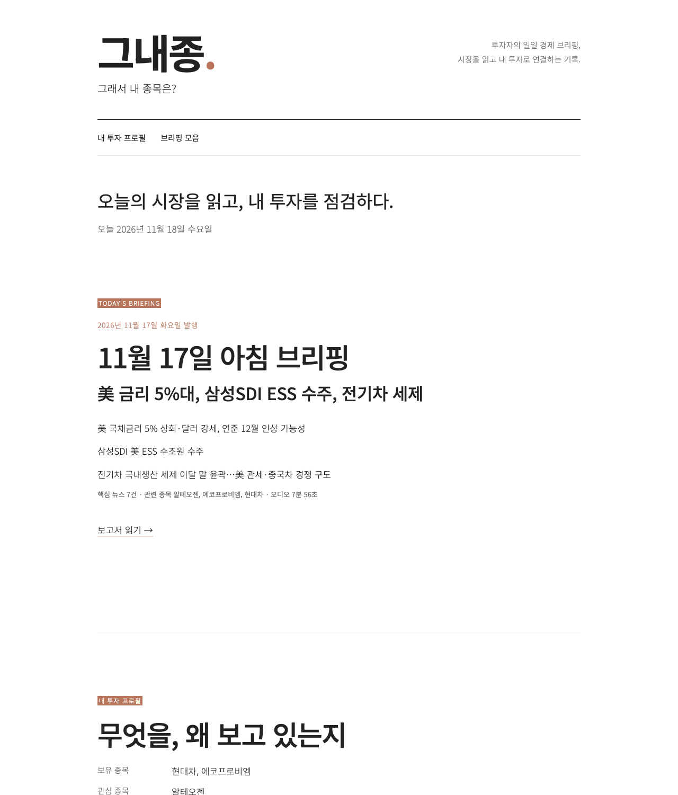
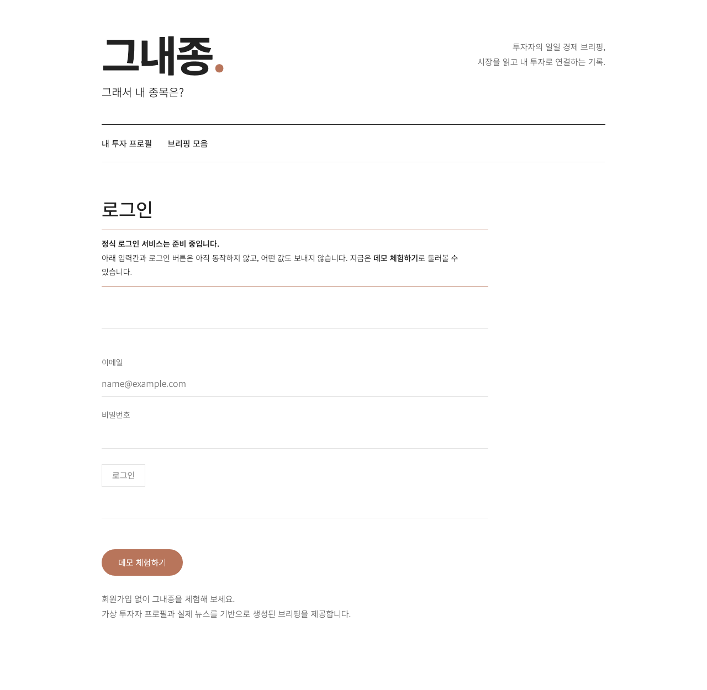

# 그내종. 그래서 내 종목은?

경제 뉴스를 듣고 **"그래서 내 종목은?"**까지 답해 주는 개인화 투자 리서치 서비스 PoC입니다.
내 투자 이유를 등록하면 국내외 경제 뉴스 수백 건 중 필요한 소식만 골라, 아침에 들을 **음성 브리핑**과 날짜별 **투자 리서치 보고서**로 만들어 줍니다.

AIFFEL 메인 퀘스트 2 "내 도메인에서 AI로 개선 지점 찾아서 PoC 만들기" 제출물입니다.
PoC의 목적은 좋은 결과를 만드는 것이 아니라 **실제로 구축할 가치가 있는지 검증**하는 것이라, 기준에 못 미친 결과와 실패 사례도 그대로 적었습니다.

> ### 데모 환경 안내
> 본 프로젝트의 공개 데모는 개인정보 보호를 위해 **가상 투자자 프로필**을 사용합니다.
> - 보유·관심 종목 설정, 투자 이유, 관심 키워드 및 위험 요인은 데모용으로 구성된 **가상 데이터**입니다.
> - 뉴스는 **실제 수집된 뉴스**(2026-11-17)를 사용했습니다.
> - 뉴스 선별, 투자 관점 분석, 경제 개념 설명, 음성 대본 및 브리핑은 **실제 AI 파이프라인을 통해 생성한 결과물**입니다.
> - PoC 성능 평가 수치는 **실제 평가 과정에서 측정한 결과**입니다. 평가 원본은 비공개이고 이 문서에는 종목명을 뺀 집계 수치만 적었습니다.
> - 실제 개인 투자 프로필과 개인 기록은 공개 저장소에 포함하지 않았습니다.
> - 본 서비스는 투자 판단을 돕는 개인 리서치 도구이며 매수·매도를 권유하지 않습니다.
>
> **테스트용 종목 검색 목록과 실제 뉴스는 별개입니다.** 기업명 검색에 쓰는 실제 상장 종목 목록은 아직 내려받지 않았습니다. 저장소에 있는 `tests/fixtures/symbols/`는 자동 테스트용으로 만든 소규모 목록이며 공식 목록이 아닙니다. 데모 화면의 뉴스와는 관계가 없습니다.

## 한눈에 보기

### 서비스 소개
보유·관심 종목과 **투자 이유**를 등록합니다. 종목명이 아니라 "왜 이 종목을 보는지"를 기준으로 AI가 뉴스를 고르고, 근거 링크가 붙은 두 진행자 대화 음성(MP3)과 보고서로 전달합니다. 보고서에서는 오늘 뉴스가 내 투자 이유를 **긍정 신호 / 위험 신호 / 판단 보류** 중 어느 쪽에 가까운지, 판단하려면 무엇을 확인해야 하는지까지 보여 줍니다.

```
실제 투자자의 문제 발견 → 정보 선별 자동화 → 음성 전달 방식 선택 → AI 기반 개인화 브리핑 구현 → 평가와 개선 → 매일 쓰는 서비스(그내종)로 확장
```

### 해결하려는 문제
작성자가 코스닥 중소형주에 직접 투자하며 겪은 세 가지입니다.

| 문제 | 실제 상황 | 그내종의 방향 |
|---|---|---|
| 정보 선별의 부담 | 키워드 알림에 무관한 기사가 섞여 몇 주 뒤 알림을 열지 않게 됐다. 하루 경제지 RSS 439건 중 내 코스닥 종목 기사는 0건이었다 | 종목명이 아니라 **투자 이유** 기준으로 AI가 고른다 |
| 정보 소비의 부담 | 뉴스를 읽으려면 화면 앞에서 따로 시간을 내야 한다 | 아침 준비·출근길에 듣는 **음성 브리핑** |
| 경제 지식 학습의 부담 | 공부할 시간을 따로 내기 어렵다 | 그날 뉴스에 나온 개념 하나와 퀴즈 하나 |

### 주요 기능
- **개인화 뉴스 선별:** 투자 이유·위험 요인·관심 산업·거시 관심사를 기준으로 AI가 관련 여부, 연결 방식, 중요도를 판정
- **편집과 대본:** 같은 사건 묶기, 근거가 약한 기사 빼기, 10~15분 시간 배분, 사실과 해석을 구분한 두 진행자 대본, edge-tts 음성
- **출처 검증:** 대본의 사실 주장마다 출처 기사 본문과 대조, 출처에서 확인되지 않는 내용은 빼기
- **일일 보고서:** 핵심 뉴스, 내 종목별 영향과 확인할 점, 추가로 볼 뉴스, 경제 개념 + 퀴즈, 메모, 다음에 점검할 것
- **프로필:** 종목 목록(접기·펼치기·보유/관심 필터), **집중 분석** 종목 지정, 기업명 검색 자동 입력(실제 목록은 환경 설정 후 사용)
- **주요 거시지표 식별:** 수집된 뉴스에서 미국·한국 주요 지표 발표 기사를 찾아 우선 편성 (기사에 있는 수치만 사용)

### 구현 화면 (가상 프로필 데모)
| 메인 | 일일 보고서 |
|---|---|
|  |  |

| 내 투자 프로필 | 로그인 (화면 시안, 데모 체험하기) |
|---|---|
|  |  |

### 데모 체험과 실행 방법
**GitHub에서 열어 볼 수 있는 것:** 이 README와 화면 캡처, 문서, 코드, 데모 결과 파일(`demo/outputs/20261117_v3/`의 `briefing.json`, `script.md`, `factcheck.md` 등).

**GitHub 접속만으로는 웹 화면을 체험할 수 없습니다.** 배포된 주소는 없고, 웹 화면과 음성 재생은 **로컬에서 서버를 실행**해야 합니다.

```bash
uv venv --python 3.12 && uv pip install -r requirements.txt
```

```bash
.venv/bin/python -m app.web_server --data demo
```

http://127.0.0.1:8777 에서 열립니다. 로그인 화면(`/login`)의 **데모 체험하기** 버튼이나 바로 `/`로 들어가면 가상 프로필 데모가 열립니다. 키와 회원가입이 필요 없고, 데모 서버는 `demo/` 데이터만 읽습니다.

**음성(MP3)은 저장소에 없습니다.** edge-tts는 Microsoft의 비공식 방식이라 재배포 조건이 확인되지 않아 MP3를 공개하지 않았습니다. 대본은 `demo/outputs/20261117_v3/script.md`에서 읽을 수 있고, 아래 명령으로 저장된 대본에서 MP3를 로컬에 다시 만들 수 있습니다(AI 호출 없음, 무료, 인터넷 연결 필요). 만든 뒤 서버를 다시 열면 보고서에서 재생됩니다.

```bash
.venv/bin/python -m app.tts demo/outputs/20261117_v3
```

### PoC 핵심 평가 결과
실제 기사 30건에 사용자가 AI 결과를 보기 전에 정답을 달고, 키워드 방식과 AI(Claude Haiku 5.5, Sonnet 5.5)를 비교했습니다. 성공 기준은 모델을 실행하기 전에 정했고 결과를 본 뒤 바꾸지 않았습니다.

| 성공 기준 (사전 설정) | 결과 | 판정 |
|---|---|---|
| 재현율 90% 이상 | 키워드 78%, **AI 74%** | **미달** |
| 정밀도 80% 이상 | 키워드 96%, AI 95% (무관 기사가 3건뿐이라 근거가 약함) | 달성 |
| 키워드보다 오탐은 줄고 누락은 같거나 적음 | 오탐 1건 대 1건(같음), 누락 6건 대 **7건(AI가 더 많음)** | **미달** |
| 같은 30건을 사람이 고르는 시간보다 짧음 | 사람 720초, AI 53~101초 | 달성 |
| 대본의 사실 100%가 출처 링크로 이어짐 | 사실 대사마다 출처 번호가 붙음. 단, 번호가 있어도 출처가 주장을 뒷받침하지 않는 사례를 찾았고 고쳤음 | 형식은 달성, 내용은 별도 검증(4절) |
| 입력부터 MP3까지 끝까지 동작 | 데모 v3 실행 완료 | 달성 |

**한 줄 결론:** 선별 정확도만 보면 AI가 키워드보다 낫다고 말할 수 없었습니다. 그 대신 숫자 뒤에서 "무엇을 정확한 결과로 볼지 먼저 정해야 한다"는 점을 발견했고, 선별 이후의 **출처 검증**이 이 서비스에서 더 큰 과제임을 실패 사례로 확인했습니다. 자세한 해석은 4~8절에 있습니다.

---

## 1. 문제 정의: 배경, 기존 방식, 병목, AI 적용 유형
자세한 내용: [docs/problem_definition.md](docs/problem_definition.md)

- **배경:** 작성자는 투자 교육 회사에서 운영 코치로 일하며 매주 "뉴스 → 무슨 일 → 왜 → 영향 산업 → 수혜 기업 → 주의할 점" 틀로 수업했고, 지금도 코스닥 중소형 성장주에 직접 투자합니다. AI 과정을 들으며 투자 정보를 챙길 시간이 크게 줄었습니다.
- **실제 사용자:** 1차는 작성자 본인(보유·관심 종목과 투자 논리는 분명하지만 매일 뉴스를 훑을 시간이 없는 개인 투자자). 같은 상황의 개인 투자자로 확장할 수 있게 프로필만 바꾸면 돌아가도록 설계했습니다.

| 단계 | 기존 방식 | 병목 |
|---|---|---|
| 수집 | 포털·경제지 앱을 직접 열거나 Google 키워드 알림 메일 | 하루 경제지 RSS만 400건 이상 (2026-11-17 실측 439건) |
| 선별 | 제목을 하나씩 보고 내 종목과 관련 있는지 판단 | 키워드가 걸린 무관한 기사가 많고, 종목명이 없는 산업·정책 기사는 놓침 |
| 이해 | 관련 기사를 읽고 영향을 정리 | 시간이 없으면 이 단계까지 가지 못함 |
| 공시 | DART에서 종목별로 따로 확인 | 뉴스와 따로 놀아 자주 빠뜨림 |

- **수집 단계에서 확인한 사실:** 같은 날 매일경제·한국경제 RSS 439건 중 등록한 코스닥 4종목의 이름이 나온 기사는 **0건**이었습니다. 같은 날 한국경제 검색으로는 이 종목들의 수주공시 기사가 바로 나왔습니다. 그래서 종목별 검색 수집을 파이프라인에 추가했습니다.
- **실제로 겪은 실패:** Google 키워드 알림을 써 봤지만 무관한 기사가 너무 많아 몇 주 뒤 알림 메일을 열지 않게 됐습니다. 정보는 충분한데 선별 비용 때문에 소비를 포기한 상태였습니다.
- **AI 적용 업무 유형:** 수업의 병목 유형으로는 **분류와 배분**(건수가 많은 기사를 관련·무관으로 가르기)이 핵심이고, 결과를 듣기 좋은 형태로 바꾸는 부분(글 → 음성)이 더해집니다. AI를 넣은 단계는 ① 선별(기사 + 투자 프로필 → 관련 여부·연결 방식·근거) ② 전달(대본 작성, 음성)입니다.
- **개선 가설:** 종목명만 보는 키워드 대신 종목별 **투자 논리**와 **거시 관심사**를 함께 준 LLM이 판정하면, 무관한 기사는 줄이고 종목명이 안 나오는 산업·정책·거시 기사는 놓치지 않는다.
- **범위:** 이번에는 수동 종목 등록, 실제 수집, AI 선별, 두 진행자 MP3, 키워드 대비 검증까지. 매일 자동 발송, 계좌 연동, 여러 사용자 계정, 매매 추천은 하지 않습니다.

## 2. 개발 전에 정한 정량적 성공 기준
모델을 실행하기 전에 고정했고, 결과를 본 뒤에도 바꾸지 않았습니다. 누락(관련 기사를 버림)은 오탐(무관한 기사를 남김)보다 위험하게 봅니다. 오탐은 흘려들으면 되지만 누락은 판단 재료가 사라지기 때문입니다.

| # | 기준 | 목표 |
|---|---|---|
| 1 | 재현율 (사람이 관련이라고 한 기사 중 AI가 남긴 비율) | 90% 이상 |
| 2 | 정밀도 (AI가 남긴 기사 중 실제 관련 비율) | 80% 이상 |
| 3 | 키워드 기준선 대비 | 오탐이 줄고 누락은 키워드 이하 |
| 4 | 처리 시간 | 같은 30건을 사람이 고르는 시간보다 짧음 |
| 5 | 근거 추적성 | 대본의 사실 100%가 원문 링크로 이어짐 |
| 6 | 끝까지 동작 | 프로필 입력 → 수집 → 선별 → 대본 → 두 목소리 MP3 |

## 3. 후보 모델, 실행 환경, 라이선스, 비용
자세한 내용: [docs/model_selection.md](docs/model_selection.md), [docs/cost_principles.md](docs/cost_principles.md), [docs/sources_and_licenses.md](docs/sources_and_licenses.md)

| 영역 | 후보와 선택 | 이유 |
|---|---|---|
| 선별 | 키워드 매칭(기준선), **Claude Haiku 5.5(기본)**, Sonnet 5.5(비교). 임베딩 유사도와 로컬 소형 LLM은 제외 | 하루 수백 건이라 건당 비용이 낮아야 함. 임베딩은 "왜 관련인지·불확실한지"를 말하지 못함. 로컬 LLM은 한국어 경제 문맥 판단력이 낮을 것으로 보고 제외(미검증) |
| 편집·대본·검증 | Sonnet 5.5 | 사람이 매일 듣는 결과물이라 대화의 자연스러움 우선. Haiku로도 규칙은 지켰고 `--script-model haiku`로 바꿀 수 있음 |
| 음성 | edge-tts (두 목소리) | 무료, 키 없음, 한국어 남녀 음성. 로컬 TTS는 두 목소리 구분이 어려워 제외. 공식 TTS는 배포 시 대안 |
| 실행 환경 | **Claude Code CLI(`claude -p`), 로컬 맥** | API 키 없이 개인 구독으로 같은 모델을 호출. 기본 지시문·도구를 끄고 구조화 출력을 써 API와 거의 같은 조건으로 맞춤 |
| 라이선스 | 모델은 제공사 이용 약관. edge-tts 라이브러리는 LGPLv3이지만 서비스 자체는 비공식 | 음성은 개인용으로만 쓰고 재배포하지 않음 |
| 비용 | 평가 30건 Haiku 약 $0.013, Sonnet 약 $0.133. 실제 하루 460건 Haiku 판정 186초, 약 $0.13 | **위 금액은 API 가격으로 환산한 추정값이며 실제 청구액이 아닙니다.** 모든 실행이 구독 CLI로 이루어졌고 종량제 API는 쓰지 않았습니다 |

**비용 원칙:** 개발과 운영에 추가 비용이 생기지 않게 합니다. 종량제 API는 키가 있어도 `ALLOW_PAID_API=1`을 직접 켜야만 쓰이도록 코드로 막았습니다. 근거와 무료 대안 검토는 [docs/cost_principles.md](docs/cost_principles.md)에 있습니다.

## 4. 평가 (비식별 집계)
실제 투자자 프로필(코스닥 보유 4종목 + 해외 관심 1종목)로 수행했고 원본은 비공개입니다.

### 4-1. 정답 데이터와 평가 방법
- **데이터:** 실제 기사 30건. 매일경제·한국경제 공식 RSS(2026-11-17 수집 439건)와 한국경제 사이트 검색에서 뽑았습니다. RSS에 등록 종목 기사가 0건이라 검색 수집을 더해 평가셋에도 썼습니다.
- **구성(뽑을 때의 의도일 뿐 정답이 아님):** 직접 관련 8, 간접 관련 8, 무관 8(키워드는 겹치지만 무관한 함정 기사 포함), 판단이 어려운 사례 6.
- **정답:** 작성자가 **AI 결과를 보기 전에 직접** 라벨을 달았습니다. 유형 여섯 가지(직접, 산업·정책, 관심 테마, 거시, 무관, 판단 보류), 중요도, 이유 한 줄. 정밀도·재현율에서는 앞의 네 유형을 "관련", 무관을 "무관"으로 묶고, 유형을 맞혔는지는 유형 일치율로 따로 봤습니다.
- **비교 대상:** A 키워드 기준선(Google 알림과 같은 방식), B1 Haiku 5.5(3회 반복), B2 Sonnet 5.5, 사람(정답이자 시간 기준선).
- **한계:** 30건은 적은 수라 숫자 하나하나의 신뢰도는 낮습니다. 제목과 RSS 요약만 보고 판단했습니다.

### 4-2. 키워드 대 AI 결과

| 방식 | 정밀도 | 재현율 | 오탐 | 누락 | 직접 관련 뉴스 누락 | 유형 일치 | 30건 처리 시간 |
|---|---|---|---|---|---|---|---|
| 키워드 | 96% | 78% | 1 | 6 | 0 | — | 0.002초 |
| Claude Haiku 5.5 (3회) | 95% | 74% | 1 | 7 | 0 | 53~57% | 80~101초 |
| Claude Sonnet 5.5 | 95% | 74% | 1 | 7 | 0 | 47% | 53초 |
| 사람 | — | — | — | — | — | — | 720초 |

**성공 기준 충족 여부** (사전 설정 기준 그대로):
- 재현율 90%: **미달** (키워드 78%, AI 74%)
- 키워드보다 개선: **미달** (오탐은 같고 누락은 AI가 1건 더 많음)
- 정밀도 80%: 달성 (무관 기사가 3건뿐이라 근거 약함)
- 사람보다 빠름: 달성 (단, AI 시간에는 사람이 결과를 훑는 시간이 빠져 있음)

결과를 본 뒤 정답과 기준을 고치지 않았습니다.

**숫자 뒤에서 찾은 것:**
- **AI만 맞힌 4건:** 모두 종목명이 나오지 않는 산업·정책·거시 기사였습니다. 가설이 맞은 부분입니다.
- **키워드만 맞힌 5건:** 모두 정답을 단 이유와 다른 단어로 우연히 걸렸습니다.
- **AI가 놓친 7건 중 6건은 요구사항 정의 문제였습니다:** 구현자가 더한 규칙이 사용자 판단과 충돌한 것 2건, 프로필에 없던 선호 2건, 라벨 체계로 담을 수 없던 "새 투자 아이디어" 의도 2건. AI 판단 오류일 가능성이 있는 것은 1건이었습니다.
- **Sonnet이 낫지 않았습니다.** 관련/무관 판정은 같았고 유형 일치율은 더 낮았습니다. 틀린 원인은 모델 크기가 아니라 지시문과 라벨 정의였습니다.
- **가장 큰 결론:** AI 정확도를 높이기 전에 무엇을 정확한 결과로 볼지 먼저 정해야 했습니다. 이 발견에서 "모니터링(재현율)"과 "기회 탐색(정밀도·근거)"을 나누는 설계가 나왔습니다.

### 4-3. 브리핑 품질 개선 (v1 → v2)

| 항목 | v1 | v2 이후 |
|---|---|---|
| 사실 오류 | 상장 기업을 "비상장"이라고 말함 (형식 점검 통과) | 사실 검증 단계 추가. 규칙과 LLM이 그 오류를 모두 검출 |
| "확인 필요" 반복 | 11회 | 0회 (상세는 텍스트 리포트로) |
| 근거 약한 기사 비중 | 12건 중 7건 | 24건 중 4건 |
| 같은 사건, 다른 매체 | 요약만 보고 같은 사건인지 모름 | 원문 대조로 같은 사건 판정 (단, 이 측정 때는 일부 '원문'이 언론사 AI 요약 상자였음, 5절) |
| 미래 기사 | 오후 테스트에 07:35 이후 기사 포함 | 수집 마감 적용. 마감 이후 181건 제외, 시간대 테스트 통과 |
| 중요 뉴스 누락 | 사유 불명 | 사유 7분류를 매일 기록. 제목만 있는 high 기사는 원문으로 근거 보강 |
| 해외 뉴스 | 국내 언론만 | CNBC·우주 전문 매체 원문 추가. 국내·해외 묶은 이야기 5개 |

### 4-4. 자동 검증이 확인하는 것과 확인하지 않는 것
"출처 없는 사실 0개"와 "사실 오류 0개"는 다른 말입니다.

| 표시 | 무엇과 대조했나 | 뜻 |
|---|---|---|
| 형식 점검: "출처 없는 사실 대사 0개" | 대본 자체 | 사실 대사마다 출처 번호가 붙어 있다. 그 출처가 내용을 뒷받침하는지는 모른다 |
| LLM 출처 대조: "중대 오류 0건" | 대사에 붙은 출처의 제목·요약 + 그 주소에서 읽히는 기자 본문(유료는 공개된 부분), 기업 사실표 | 이 근거들과 어긋난 주장을 찾지 못했다. **독립적인 사실 검증 완료가 아니다** |
| 확인 불가 | 같은 출처 | 확인할 수 없는 주장은 틀렸다고도 맞다고도 하지 않고 대본과 확인된 사실에서 뺀다 |
| 출처-주장 일치 | 같은 출처의 제목·읽히는 본문 | 사실 대사의 숫자와 등록 기업명이 출처에 글자 그대로(또는 단위 환산해서) 있다. 숫자가 없는 주장은 이 검사로 보지 않는다 |
| **하지 않는 것** | 공식 통계·공시 원문(BLS·FRED·DART 등), 출처 기사 자체의 정확성 | 기사들이 공통으로 틀렸거나 공식 수치와 다르면 잡지 못한다 |

> 웹 화면에서는 읽는 흐름을 위해 출처 대조 수치와 "확인 불가" 칸을 보이지 않게 했습니다(2026-11). 검증은 그대로 수행하고 결과는 `briefing.json`의 `checks`, `factcheck.md`에 남아 있습니다.

## 5. 실패 사례: 발견, 원인, 개선
공개 데모 대본을 사람이 직접 검토하다 찾았습니다. 이전 대본과 재검사 기록은 지우지 않고 보존했습니다. 전체 기록: [docs/failure_cases_demo.md](docs/failure_cases_demo.md)

| # | 실패 사례 | 무엇을 발견했나 | 원인 | 개선 |
|---|---|---|---|---|
| 1 | **언론사 AI 요약을 기자 본문으로 잘못 추출** | "원문 확인"으로 표시된 근거가 한국경제의 "AI 기사요약" 상자(매일경제는 AI 종목 카드)였다 | 원문 읽기가 본문 영역을 가리지 않고 페이지 텍스트를 읽었다 | 요약 상자를 지우고 본문 영역(`articleBody` 등)만 읽는다. 유료 기사는 공개분만 읽고 `partial`로 표시 |
| 2 | **기사 출처와 실제 주장이 불일치** | 다른 기업(롯데칠성) 실적 기사를 출처로 데모 보유 종목의 4분기 전망 하향 수치를 말했다. 그 본문에는 해당 종목도 수치도 없었다 | 검증이 출처 번호와 제목·요약만 봤고, 숫자는 검색 결과 요약에만 있었다 | 출처별로 제목·요약·읽히는 본문을 따로 주고, 본문에 없고 요약에만 있는 주장은 중대 오류로 판정. 숫자·기업명 일치 검사 추가 |
| 3 | **잘못된 인과 해석** | 미 국채금리 5% 복귀를 "안전자산 선호가 반영됐다"고 설명했다. 기자 본문은 "높은 물가 발표 뒤에야 5%를 다시 넘었다"고 썼다 | 인과 근거가 AI 요약 상자의 문장이었다(1번과 같은 원인) | 인과는 출처가 그렇게 분석했을 때만 인정하고 대본도 "기사는 ~로 분석했다"로 말하게 함. 경제적으로 앞뒤가 안 맞는 인과는 중대 오류 |
| 4 | **확인되지 않은 기업 실적 수치** | 위 2번의 수치가 "근거와 일치"로 자동 검증을 통과했다 | 사실 검증이 검색 요약을 근거로 인정했다 | 검색 요약은 본문을 못 읽은 경우에만 근거로 쓰고, 마지막 관문에서 숫자·기업명이 출처에 없으면 그 문장을 지운다. 이전 대본을 새 기준으로 다시 검사하면 문제 5건(중대 2)이 나오고, 다시 만든 대본은 중대 0 |
| 5 | **분석 결과가 다른 뉴스에 연결된 매핑 오류** | 웹 보고서의 한 이야기에 다른 이야기(정상회담, 코픽스)의 사실이 붙었다 | 원문 대조 대상이 아닌 이야기가 중간에 있으면 모델이 이야기 번호를 1부터 다시 매겼고 코드가 번호를 믿었다 | 돌려받은 번호를 믿지 않고 근거 기사가 그 이야기의 기사일 때만 붙임. 이야기 연결 규칙 테스트(`tests/test_links.py`) 추가. 대본·음성은 영향 없었음 |
| 6 | **복합 숫자 표기 환산의 한계** | "8억 2,500만 주"를 "825 million"과 같은 값으로 환산하지 못해 맞는 문장 일부를 뺐다(과잉 차단) | 일치 검사가 복합 수 표기를 환산하지 못한다 | 틀린 내용이 들어가지는 않았고 안전한 쪽으로 빠졌다. **고치지 않았고 후속 과제**로 남겼다 |

같은 검토에서 대본의 맞춤법 오류("어느지")도 찾았습니다. 사실 검증이 맞춤법을 보지 않기 때문이며 해당 대사만 고쳤고, 자동 점검은 아직 없습니다. "중대 오류 0건"이 독립적 검증처럼 읽히는 표현도 "출처 대조"로 바꾸고 범위를 함께 적었습니다.

**결과 요약:** 가상 프로필 데모 최종 사실 주장 23개 중 출처와 어긋난 주장 0건(v3). 실제 프로필 재생성(비공개, 집계)은 사실 주장 38개 중 어긋난 주장 0건이며, 새 검사가 1회차에 중대 2건과 2회차에 경미 1건을 실제로 잡아 고쳤습니다.

## 6. PoC로 확인한 것과 확인하지 못한 것

**확인한 것**
- 프로필 입력부터 수집, 선별, 편집, 대본, 출처 검증, 두 목소리 MP3, 웹 보고서까지 한 번에 실행된다.
- 30건 기준으로 AI의 선별 정확도는 키워드를 넘지 못했다. 다만 종목명이 없는 산업·정책·거시 기사는 AI만 맞혔다.
- 출처 번호가 붙어 있어도 출처가 주장을 뒷받침하지 않을 수 있다. 출처 검증은 별도 단계가 필요하다(실패 사례 1~5).
- 선별 단계의 처리 시간은 사람보다 짧다(53~101초 대 720초).

**아직 확인하지 못한 것**
- 정보 탐색 시간 절감과 학습 효과(측정 전. 계획: [docs/consumption_eval_plan.md](docs/consumption_eval_plan.md))
- 더 많은 데이터에서의 선별 성능. 30건은 적고, 새 데이터로 라벨을 달아 재검증하지 않았다
- **집중 분석이 뉴스 선별과 분석 품질에 미치는 효과.** 구현했고 AI 호출 없는 테스트와 화면은 확인했지만, 켰을 때와 껐을 때의 결과 비교는 하지 않았다
- 주요 거시지표 반영의 품질(구현과 1회 생성만 했고 평가 수치는 만들지 않았다)
- 공식 통계·공시 원문과의 대조, 복합 숫자 표기 환산, 맞춤법 자동 점검
- 미국 종목의 뉴스·공시 분석, 여러 사용자 환경, 외부 접속
- 사람이 직접 듣고 하는 발음·자연스러움 점검

## 7. 결론: 실제 서비스를 구축할 가치가 있는가
- **뉴스 선별 성능은 사전에 설정한 성공 기준에 미달했고, 기존 키워드 방식보다 높은 성능을 입증하지 못했습니다.** 30건 평가에서 AI의 재현율은 74%로 목표 90%에 못 미쳤고, 키워드 대비 기준(오탐은 줄고 누락은 같거나 적음)도 채우지 못했습니다.
- **다만 구현 가능성은 확인했습니다.** 개인 투자 이유를 반영한 뉴스 분석, 경제적 맥락 설명, 출처 검증을 거친 음성 브리핑 생성이 입력부터 MP3까지 실제로 동작했습니다. 종목명이 없는 산업·정책·거시 기사는 AI만 맞혔고, 놓친 기사의 대부분은 모델 한계가 아니라 요구사항 정의 문제였습니다.
- **앞으로:** 기존 키워드 방식과 AI 분석을 **결합한 구조**를 추가로 검증하고, 작성자가 실제 개인 투자 리서치 서비스로 활용하면서 지속적으로 개선할 예정입니다. 비용이 추가로 생기지 않는 범위에서만 확장합니다.

## 8. 웹 서비스 구성과 동작 상태
```
로그인 (화면 시안 + 데모 체험하기) → 메인 → 날짜별 일일 보고서 (브리핑 모음)
                                       └→ 내 투자 프로필 (종목 목록, 집중 분석)
```
상단 메뉴는 **내 투자 프로필**과 **브리핑 모음** 두 개이고, "그내종." 로고를 누르면 메인으로 갑니다.

| 화면 | 내용 | 상태 |
|---|---|---|
| 메인 `/` | 최신 보고서, 프로필 요약, 지난 브리핑, 아직 점검하지 않은 항목 | 로컬 실제 동작 |
| 일일 보고서 `/report/<id>` | 이전 보고서 확인하기, 제목·음성·핵심 요약 / 01 주요 경제·산업 뉴스 / 02 그래서 내 종목은?(긍정·위험·판단 보류 신호, 관련 뉴스 링크, 확인할 것, 점검 리스트) / 03 추가로 보면 좋을 뉴스 / 04 경제 개념 + 05 퀴즈 / 메모와 다음에 점검할 것 | 로컬 실제 동작 |
| 브리핑 모음 `/archive` | 가장 최근 보고서로 이동. 다른 날짜는 보고서 위쪽 "이전 보고서 확인하기"에서 선택 | 로컬 실제 동작 |
| 내 투자 프로필 `/mypage` | 관심 영역, 종목 목록(접기·펼치기, 전체·보유·관심 필터, 집중 분석, 추가 요청사항, 삭제 취소, 하단 저장 영역), 기업명 검색 자동 입력 | 로컬 실제 동작. 실제 종목 목록은 환경 설정 후 사용 |
| 최초 프로필 설정 `/onboarding` | 프로필에 종목이 없으면 메인에서 이 화면으로 보냄 | 로컬 실제 동작 |
| 개발·평가 기록 `/records` | 승인판이 아닌 실행과 승인 관문을 통과하지 못한 이유 | 로컬 실제 동작 |
| **로그인 `/login`** | **화면 시안만.** 입력칸과 버튼은 비활성화되어 있고 어떤 값도 보내지 않는다. 가짜 인증은 만들지 않았다. **데모 체험하기** 버튼은 서버가 가상 프로필 데모 모드일 때만 나타나 `/`로 이동한다. 실제 데이터 서버에서는 버튼이 나타나지 않아 데모 경로로 개인 데이터에 들어갈 수 없다 | 인증 **미구현** |
| 계정 설정 | 비밀번호, 데이터 내보내기·삭제, 탈퇴 | 후속 개발 |

- **인증이 없으므로** 서버는 기본으로 이 컴퓨터(127.0.0.1)에서만 열립니다. 인증과 사용자별 접근 권한을 만들기 전에는 실제 개인 데이터를 담은 서비스를 공개 배포하지 않습니다. 설계: [docs/auth_design.md](docs/auth_design.md)
- **날짜별 최종 승인판:** 일반 목록에는 날짜마다 승인판 하나만 나옵니다. 테스트 실행과 수정 전 판은 지우지 않고 '개발·평가 기록'으로 보관합니다. 승인 관문(`app/release.py`)은 MP3, 출처 대조 중대·경미 0건, 출처-주장 일치 0문장 등을 요구합니다.
- **데이터 분리:** 메모와 점검 목록(`userdata/`)은 브리핑과 따로 저장해, 새 보고서가 생겨도 지워지지 않습니다.
- **디자인:** 흰 바탕 #FFFFFF, 차콜 #222222, 단일 포인트 테라코타 #B8755B, 고딕체(Noto Sans KR), 얇은 구분선, 넉넉한 여백. 공통 스타일 `web/style.css`. 정리: [docs/design_system.md](docs/design_system.md)
- **모바일:** 주요 화면을 아이폰 폭(375px)에서 가로 스크롤 없이 확인했습니다.
- **배포 준비:** 화면은 JSON API만 부르고 저장소는 한 클래스로 분리해 두었습니다 ([docs/web_service.md](docs/web_service.md)).

## 9. 시스템 구조
```
투자 프로필 (userdata/profile.json ← 웹에서 수정)
  │
  ├─ 수집   국내: 매경·한경 RSS + 한경 종목 검색 / 해외: CNBC RSS + Spaceflight News API / 공시: OpenDART(키 있을 때)
  │        수집 마감 시각(07:35 KST) 이전 발행 기사만
  ├─ 선별   Claude Haiku 5.5: 유형·중요도·근거·확인된 사실 (집중 분석 종목이 있으면 그 지침 추가)
  ├─ 편집   Claude Sonnet 5.5: 같은 사건 묶기, 근거 약한 기사 빼기, 시간 배분, 중요 뉴스 누락 사유 기록. 주요 거시지표 발표 기사 식별
  ├─ 원문 대조 중요 이야기는 원문을 읽어 같은 사건인지와 확인된 사실 정리 (원문은 저장 안 함)
  ├─ 대본   Sonnet 5.5: 무슨 일 → 왜 → 영향 → 내 종목 → 더 볼 것, 사실과 해석 구분
  ├─ 사실 검증 기업 사실표(공식 자료) + 주장별 출처 대조 → 수정 → 재검증
  ├─ 음성   edge-tts 두 목소리 → MP3 (음성 전용 읽기 사전)
  └─ 웹 데이터 briefing.json: 핵심 뉴스, 내 종목 관점, 추가 뉴스, 800선 개념, 퀴즈, AI 추천 점검
                                                │
                     로컬 웹 서버 (app/web_server.py) ── 화면 (web/) ── 사용자 데이터 (프로필·메모·점검 목록, 따로 저장)
```
- **결과물 분리:** AI가 만든 결과(`<결과 폴더>/<날짜>/briefing.json`)와 사용자 데이터(`userdata/`)는 따로 저장합니다.
- **검증된 데이터만 사용:** 웹의 핵심 뉴스와 AI 추천은 사실 검증을 마친 편성표와 원문 대조 결과에서만 만듭니다.

### 집중 분석과 종목 검색 (구현 상태)
- **집중 분석 (구현, 효과 미검증):** 종목별로 켜고 끌 수 있고 기본은 해제입니다. 보유·관심 구분과 별개입니다. 선별·편집·보고서 분석·대본 프롬프트에 "그 종목과 실제로 관련된 뉴스만 투자 이유와 위험 요인에 비춰 더 깊게 다루고, 관련성이 낮은 뉴스를 넣거나 뉴스가 없는 날 내용을 만들지 않으며, 다른 종목의 중요한 뉴스를 빼는 근거로 쓰지 않는다"는 지침이 붙습니다. 편집 전 규칙 점수에는 관련 기사에 한해 0.3점만 더합니다. **AI 호출 없는 테스트(`tests/test_focus.py`)와 화면은 확인했습니다. 켰을 때와 껐을 때의 실제 선별·분석 품질 비교는 하지 않았습니다.**
- **기업명 검색 (UI 구현, 실제 목록 미설치):**
  - 구현 완료: 검색·자동 입력 UI(기업명과 코드·티커, 시장, 상장 국가 표시, 중복 등록 방지, 목록에 없으면 직접 입력)
  - 검증 완료: 테스트용 소규모 목록으로 기능 검증(`tests/test_symbols.py`와 화면)
  - **미완료: 실제 국내·미국 종목 목록 다운로드.** 실제 종목 데이터 검색은 환경 설정(OpenDART 키, SEC User-Agent)과 다운로드 이후에 사용할 수 있습니다. **종목 직접 입력은 지금도 가능합니다.**
  - 설정 방법과 환경변수 이름은 [docs/roadmap_post_poc.md](docs/roadmap_post_poc.md) 3절. 국가는 상장 시장의 국가 기준입니다.
- **미국 종목:** 등록은 되지만 지금은 기존 뉴스 수집 범위 안에서만 분석합니다. 미국 종목 전용 뉴스 수집과 SEC 공시 연동은 미구현입니다(화면에도 안내).

## 10. 공개 데모 (가상 프로필)

| 구분 | 내용 |
|---|---|
| 프로필 | **가상.** `demo/profile_demo.json`: 완성차·2차전지 소재(보유), 바이오 플랫폼(관심). 시연을 위해 고른 실제 상장사이며 누구의 실제 보유 내역도 아니고 투자 권유도 아니다 |
| 뉴스 | **실제.** 2026-11-17 수집, 수집 마감 07:35 KST |
| 승인판 | `demo/outputs/releases.json`: 2026-11-17 → `20261117_v3`. 일반 목록에는 이 판만 나온다 |
| 현재판 v3 | 후보 336건 → AI 관련 68건 → 이야기 7개(기사 20건, 기자 본문 확인 18/19) → 대본 → 출처 대조 3회(1회차 중대 1건 수정) → 최종 사실 주장 23개 중 어긋난 주장 0건 → 7분 56초 MP3 → briefing.json |
| v4 (기록판) | 10~15분 길이와 주요 거시지표 식별을 반영해 다시 만든 실험판. 측정 13분 59초, 사실 주장 32개 중 어긋난 주장 0건. 주요 지표 중 미국 CPI 발표 결과만 찾았고(FOMC는 발표 예정으로 분류) 나머지는 "찾지 못함"으로 기록했다. 승인판은 아니며 개발·평가 기록(`/records`)에서 열 수 있다. 품질 평가 수치는 만들지 않았다 |
| 이전판 | 수정하지 않고 보존: `20261117`(출처 오류가 있던 첫 대본과 재검사 기록), `20261117_v2`(출처 오류를 고친 대본) |
| 공개 파일 | `demo/outputs/<판>/`의 briefing.json, script.json·script.md, selection_report.md, corroboration.md, factcheck.md 등 |
| 공개하지 않는 것 | MP3(비공식 음성 재배포 조건 미확인), 수집 원본(기사 요약 전체) |

## 11. 실행 방법
위 "데모 체험과 실행 방법"의 설치와 서버 실행에 더해:

**가상 프로필로 브리핑 다시 만들기** (로그인된 Claude Code CLI 필요. **구독 사용량을 소모**하므로 필요할 때만):
```bash
.venv/bin/python -m app.pipeline --mode live --collect --export --profile demo/profile_demo.json --facts demo/company_facts.json --out-root demo/outputs
```

**내 프로필로 쓰기:** `--data real`로 서버를 열면 최초 프로필 설정 화면(`/onboarding`)에서 프로필을 입력합니다(`profiles/profile_template.json` 참고). 파이프라인은 `--export`로 실행합니다. 매일 07:35 자동 실행은 `deploy/install_launchd.sh`로 등록할 수 있습니다(아직 미등록, [docs/delivery.md](docs/delivery.md)).

**검사** (모두 AI 호출 없음):
```bash
.venv/bin/python -m tests.test_time
```
```bash
.venv/bin/python -m tests.test_links
```
```bash
.venv/bin/python -m tests.test_focus
```
```bash
.venv/bin/python -m tests.test_symbols
```
```bash
.venv/bin/python -m tests.test_llm_backend
```
```bash
.venv/bin/python scripts/check_links.py
```
```bash
.venv/bin/python scripts/privacy_check.py
```
- `test_time`: 시간대·수집 마감 / `test_links`: 출처-이야기 연결 규칙 / `test_focus`: 집중 분석 저장·프롬프트 / `test_symbols`: 종목 검색(테스트용 목록) / `test_llm_backend`: 유료 API 자동 선택 방지
- `check_links.py`: 저장된 모든 브리핑의 연결 점검 / `privacy_check.py`: 공개 전 실제 투자 정보 노출 검사

## 12. 현재 구현된 기능과 미구현 기능

| 구분 | 내용 |
|---|---|
| 구현 | 수집, AI 선별, 편집, 원문 대조, 대본, 출처 검증, 두 목소리 음성, 일일 보고서, 메인·프로필·브리핑 모음 화면, 메모·점검 목록, 종목 목록 UI, 집중 분석(효과 미검증), 기업명 검색 UI(테스트 목록으로 검증), 10~15분 길이와 거시지표 식별(실험판 v4), 승인 관문, 로그인 데모 체험 경로 |
| 화면만 | 로그인·회원가입 (인증 없음) |
| 미구현 | 실제 로그인과 다중 사용자, 외부 접속 배포, 아이폰 재생 경로, 07:35 자동 실행 등록, 공식 거시지표 데이터 연동, 생성 알림, 실제 종목 목록 설치, 미국 종목 뉴스·SEC 공시, 공식 통계·공시 대조, 복합 숫자 환산, 맞춤법 점검, 소비 경험 평가(7일 청취), AI 키워드 추천, 투자 이유 변경 이력, 종목별 브리핑 모아보기 |

## 13. 개인정보와 저작권
- **비공개 (`.gitignore`):** 실제 투자 프로필, 웹에서 입력한 사용자 데이터(메모·점검 목록), 30건 평가 원본과 실행 결과, 실제 종목이 들어간 작업 문서, 실제 브리핑, 수집 원본, 한국은행 PDF와 용어 색인, 종목 목록 내려받은 파일(`data/symbols/`), `.env`
- **노출 검사:** `scripts/privacy_check.py`가 비공개 프로필에서 종목명·코드·투자 이유 문장을 뽑아, 공개될 파일과 Git 기록 전체를 검사합니다.
- **지시문 예시:** 판정·대본 지시문의 실제 종목 예시는 코드에서 빼고 프로필에서 읽도록 바꿨습니다. 비공개 프로필에는 평가 당시와 같은 문구가 있어 평가 조건은 그대로입니다.
- **한국은행 『경제금융용어 800선』:** "All Rights Reserved"입니다. PDF와 색인은 공개하지 않고, 화면에는 정의 첫 문장만 출처·쪽수와 함께 인용합니다. 이번에는 목차 기준 701개 용어를 색인했습니다.
- **기사:** 제목, 짧은 요약, 링크만 저장합니다. 원문은 검증하는 순간에만 읽고 저장하지 않습니다.
- **음성:** edge-tts는 비공식 서비스라 개인용으로만 쓰고 MP3를 공개하지 않습니다. 배포 시 공식 TTS로 바꿔야 합니다.
- **API 키:** 저장소에 키를 두지 않습니다(`.env`는 제외, `.env.example`은 이름만).

## 14. 후속 개발
이 저장소는 **PoC 제출 버전**이고, 작성자가 매일 쓰는 **실제 운영 버전**은 따로 관리합니다. 실제 로그인·배포·아이폰 재생·매일 자동 실행·거시지표 공식 데이터 연동·알림·집중 분석 효과 검증·미국 주식 뉴스와 SEC 공시·백업·비용 관리 등 항목별 계획과 무료 운영 제약은 [docs/roadmap_post_poc.md](docs/roadmap_post_poc.md), 비용 원칙은 [docs/cost_principles.md](docs/cost_principles.md)에 있습니다.

이 서비스는 매수·매도를 권하지 않으며, 주가 예측이나 주문 실행을 하지 않습니다.
