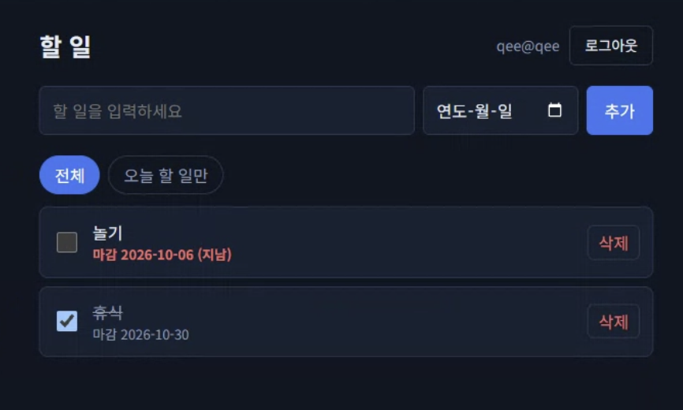

# AIFFEL Campus Agent Code Review Templete
- 개발자 : castlegyun
- 리뷰어 : Rose Kim (k-im-rose)

# ART(Agent Review Template)
**O 1. 원하는 기능이 의도한 대로 동작하나요?**
- PRD의 기본 기능(추가 / 목록 / 완료 / 삭제)과 추가 기능(마감일 표시, 오늘 할 일만 보기), 길 B 기능(회원가입·로그인·로그아웃, 내 할 일만 보기)이 모두 구현되어 있습니다.
- 배포 URL(https://todo-app-iw2l.onrender.com)에서 직접 가입·로그인 후 테스트했습니다.
  - 할 일 추가, 마감일 지정, 완료 체크(취소선), 삭제 모두 정상 동작
  - 마감일이 지난 미완료 항목은 빨간색 `(지남)`으로 표시됨
  - 로그인하지 않고 `/api/todos`를 호출하면 `401`이 반환됨
- 실행 화면:

  

- `evidence/` 폴더에 로컬(SQLite)·클라우드(Supabase)·RLS 확인 화면이 장면별로 정리되어 있어 근거가 충분합니다.

**O 2. 보안 검토를 수행했나요?**
- **민감 정보 하드코딩 없음**: 키는 `.env`에서만 읽고, `.env`는 `.gitignore`에 포함되어 있습니다. 커밋 이력 전체에서도 Supabase 키나 토큰이 발견되지 않았습니다. `.env.example`에는 빈 값만 있습니다.
- **service_role 키 미사용**: 백엔드가 로그인한 사용자의 토큰으로 Supabase를 호출하므로 RLS가 실제로 적용됩니다. 화면 JS에는 Supabase 주소·키가 없습니다.
- **토큰 보관**: 로그인 토큰을 `httpOnly` + `SameSite=Lax` 쿠키에 담아 화면 JS에서 접근할 수 없게 했습니다. (배포 시 `Secure`도 켜짐)
- **RLS 정책**: `user_id default auth.uid()`로 소유자를 DB가 직접 기록하고, select/insert/update/delete 4개 정책을 모두 `user_id = auth.uid()`로 제한했습니다. `anon` 권한도 `revoke`해 두었습니다. 계정 2개로 조회·수정·삭제·위조 INSERT까지 확인한 기록이 있습니다.
- **입력값 검증**: 제목 공백·200자 초과, 마감일 형식, `is_done` 타입을 백엔드에서 검사하고, DB에도 `check` 제약이 있습니다. 화면은 `textContent`로만 출력해 XSS 위험이 낮습니다.
- **의존성**: flask, requests, python-dotenv, gunicorn 등 널리 쓰이는 패키지만 사용합니다. 다만 버전이 고정되어 있지 않습니다. (아래 개선 제안 참고)

**X 3. 에러가 난 부분을 디버깅하여 "문제를 해결한 기록"을 남겼나요?**
- 전환 결과(SQLite → Supabase)와 RLS 확인 결과는 잘 정리되어 있습니다.
- 하지만 **"어떤 에러가 났고 어떻게 고쳤는지"에 대한 기록은 찾지 못했습니다.** 커밋이 5개이고 첫 커밋에 코드 전체가 한 번에 올라가 있어, 에이전트가 만든 코드의 오류를 발견·수정한 과정이 남아 있지 않습니다.
- README에 "트러블슈팅" 섹션을 추가해, 예를 들어 이메일 인증(Confirm email) 문제, Render 배포 중 겪은 문제, RLS 정책을 처음 적용했을 때의 오류 등을 한 줄씩이라도 남기면 좋겠습니다.

# 참고 링크 및 코드 개선

## 1.리뷰 시 참고한 링크가 있다면 링크와 간략한 설명을 첨부합니다.
- [Supabase Row Level Security](https://supabase.com/docs/guides/database/postgres/row-level-security): RLS 정책 작성 방법과 `(select auth.uid())` 형태 권장 이유 확인
- [Supabase Auth - Sign out](https://supabase.com/docs/reference/javascript/auth-signout): 로그아웃 시 세션(리프레시 토큰) 폐기 범위 확인
- [OWASP Secure Headers Project](https://owasp.org/www-project-secure-headers/): 기본 보안 헤더 권장 사항

## 2.리뷰를 통해 개선을 제안할 부분이 있다면 내용과 간략한 설명을 첨부합니다.
1. **README 실행 방법 수정** (`README.md`의 "실행" 부분)
   - `cd Todo`라고 되어 있는데 실제 저장소 폴더는 `todo-app`입니다.
   - `copy .env.example .env`는 Windows 명령이라 macOS/Linux에서는 `cp .env.example .env`가 필요합니다. 두 가지를 함께 적어 두면 좋겠습니다.
2. **"지남" 판정 기준 시간대 통일** (`static/app.js`의 `todayString()`)
   - "오늘 할 일" 필터는 서버의 `APP_TIMEZONE`(Asia/Seoul) 기준인데, `(지남)` 표시는 브라우저의 로컬 시간 기준입니다. 해외 시간대 사용자는 두 기준이 어긋날 수 있습니다. 서버가 `today` 값을 함께 내려주거나, 화면에서도 `Asia/Seoul` 기준으로 계산하면 일관됩니다.
3. **로그아웃 시 세션 폐기 보완** (`app.py`의 `logout()`)
   - access 토큰 쿠키가 만료된 뒤 로그아웃하면 Supabase에 로그아웃 요청을 보내지 않아, 리프레시 토큰이 서버 쪽에서는 계속 유효합니다. 쿠키가 없으면 refresh 쿠키로 먼저 갱신한 뒤 로그아웃을 호출하면 더 깔끔합니다.
4. **보안 헤더 추가**
   - 배포 응답에 `Content-Security-Policy`, `X-Frame-Options`, `X-Content-Type-Options`가 없습니다. `@app.after_request`에서 몇 줄로 추가할 수 있습니다.
5. **의존성 버전 고정** (`requirements.txt`)
   - 버전이 없어 나중에 배포할 때 다른 버전이 설치될 수 있습니다. `pip freeze`로 확인한 버전을 적어 두면 재현성이 좋아집니다.
6. **Supabase 오류 코드 구분** (`app.py`의 `rest()`)
   - Supabase가 403(RLS 위반)이나 5xx를 돌려줘도 모두 `400`으로 바뀝니다. 사용자 메시지는 그대로 두더라도 상태 코드를 구분하면 디버깅이 쉬워집니다.
7. **legacy-sqlite 실행 가능 여부** (`legacy-sqlite/app.py`)
   - `static_folder="static"`을 쓰는데 `legacy-sqlite/` 안에 `static/` 폴더가 없어 그대로는 화면이 뜨지 않습니다. 보관용이라면 README에 "실행용 아님"을 적거나, 실행 방법을 함께 남기면 좋겠습니다.
8. **이메일 형식 검사**
   - 백엔드는 `@` 포함 여부만 확인해서 `qee@qee` 같은 주소도 가입됩니다. 과제 범위에서는 문제없지만, 실제 서비스라면 Supabase 이메일 인증을 켜 두는 것이 좋습니다.

# 총평
PRD → 로컬 SQLite → Supabase(Auth + RLS) → Render 배포까지 단계가 깔끔하게 이어지고, 각 단계의 근거(스크린샷, RLS 확인 표)가 잘 정리된 프로젝트입니다. 특히 키를 백엔드에만 두고, 토큰을 `httpOnly` 쿠키로 보관하고, `service_role` 없이 사용자 토큰으로 RLS를 실제 적용한 구조가 보안 면에서 모범적입니다. 코드도 짧고 읽기 쉽습니다.
아쉬운 점은 디버깅·문제 해결 과정이 기록으로 남아 있지 않다는 것입니다. 에이전트와 작업하면서 막혔던 부분과 해결 방법을 README에 짧게라도 추가하면 과제 기준을 모두 충족할 것 같습니다. 고생 많으셨습니다!
