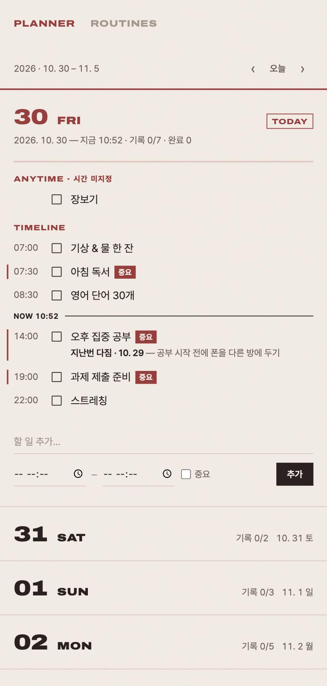
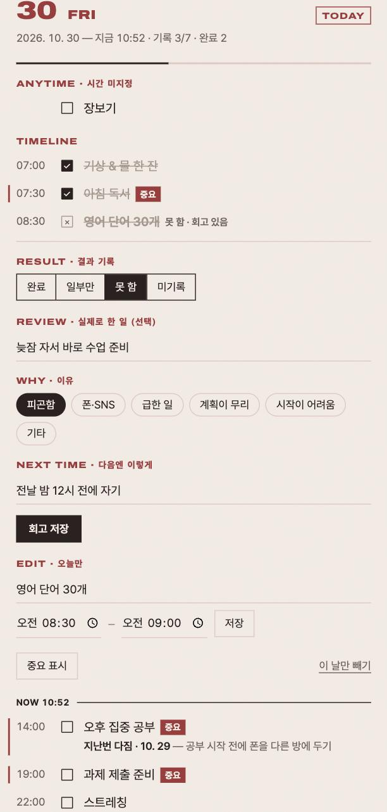
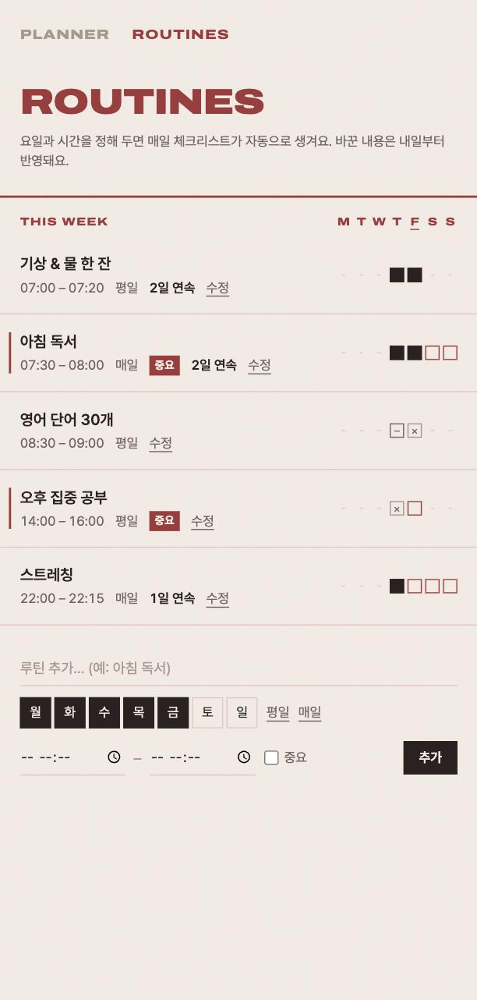

# 루틴 플래너

루틴을 매일 체크리스트로 만들어 지키고, 못 지킨 이유를 회고해서 다음엔 같은 실수를 하지 않게 돕는 Todo 앱.
모두의연구소(MODULABS) 바이브 코딩 수업 9장 「실습·과제와 마무리」의 'Todo 앱 만들기' 과제로, 에이전트(Claude Code)와 함께 만들었다.

- **사이트:** https://aiffel-todo-app.onrender.com (로그인 필요 · 무료 서버라 오래 안 쓰면 첫 접속이 30초~1분 걸린다)
- **저장소:** https://github.com/k-im-rose/aiffel/tree/main/todo-app (과제 모음 저장소 `aiffel` 안의 폴더)
- 무엇을 만드는지: [PRD.md](PRD.md)
- DB 구조: [DB-구조.md](DB-구조.md)
- 리뷰 양식: [Review.md](Review.md) (ART — Agent Review Template)

| 플래너 | 회고 | 루틴 |
|---|---|---|
|  |  |  |

> 화면의 데이터는 `npm run seed`로 넣은 **예시 데이터**다. 실제 개인 일정은 저장소에 올리지 않는다.

## 빠른 시작 (리뷰어용)

Node.js 22 이상(LTS 권장)이 필요하다.

```bash
git clone https://github.com/k-im-rose/aiffel.git
cd aiffel/todo-app
npm install
npm run seed   # 예시 데이터 넣기 (선택)
npm run dev    # http://localhost:3000
npm test       # PRD 확인표 + 보안 자동 점검 (10개)
```

- 데이터는 프로젝트 폴더의 `todo.db`(SQLite)에 저장된다. 이 파일은 `.gitignore`에 있어 Git에 올라가지 않는다.
- 다른 DB 파일로 실행하려면 `DB_FILE=demo.db npm run dev` (macOS·Linux).

### 두 가지 저장 방식

| 모드 | 언제 | 로그인 | 데이터 위치 |
|---|---|---|---|
| **로컬 (버전 1, 길 A)** | `.env`에 Supabase 값이 없을 때 (기본) | 없음 | 이 폴더의 `todo.db` (SQLite) |
| **Supabase (버전 2, 길 B)** | `.env`에 `SUPABASE_URL`, `SUPABASE_ANON_KEY`가 있을 때 | 이메일 로그인 (Supabase Auth) | Supabase(Postgres), RLS로 사용자별 분리 |

Supabase 모드로 실행하기:
1. Supabase 프로젝트를 만들고 **SQL Editor**에서 [`supabase/schema.sql`](supabase/schema.sql)을 실행한다 (표, RLS 정책, 날짜별 목록 함수).
2. **Project Settings → API Keys**에서 프로젝트 주소와 **publishable(공개용) 키**를 `.env`에 넣는다 (`.env.example` 참고). secret(관리자) 키는 쓰지 않는다.
3. `npm run dev` → 로그인 화면이 나오면 가입·로그인한다.

## 리뷰 기준(ART)별로 볼 곳

| ART 항목 | 근거 |
|---|---|
| 1. 기능이 의도대로 동작하나 | [PRD 완료 기준](PRD.md#완료-기준--버전-1-확인표) → [자동 테스트](test/api.test.js) · [테스트 결과](docs/test-result.txt) · 위 화면 캡처 |
| 2. 보안 검토 | 아래 [보안 검토](#보안-검토) · [RLS 켜짐 확인](docs/screenshots/4-supabase-rls.png) · [두 계정 RLS 확인](docs/screenshots/5-rls-two-accounts.png) |
| 3. 디버깅 기록 | 아래 [디버깅 기록](#디버깅-기록) · [개발 기록](#개발-기록) |
| 프롬프트 품질 | 아래 [에이전트에게 한 요청](#에이전트에게-한-요청) |

## 폴더

- `server/db.js` — DB 연결과 표 만들기
- `server/index.js` — 백엔드 API (`/api/...`). DB는 여기서만 접근하고, 입력값을 검사한다.
- `public/` — 화면(HTML·CSS·JS). 백엔드 API에만 요청한다.
- `scripts/seed.js` — 예시 데이터
- `test/api.test.js` — PRD 확인표 자동 테스트 (임시 DB로 서버를 띄워 점검)
- `docs/` — 화면 캡처, 테스트 결과

## 화면

- **PLANNER** — 오늘부터 7일이 `30 FRI`처럼 날짜·요일로 쌓인다. 오늘이 펼쳐져 있고, 다른 날을 누르면 펼쳐진다. 체크박스로 완료, 항목을 눌러 일부만·못 함과 회고를 기록한다. 같은 루틴의 지난 회고가 '지난번 다짐'으로 보인다. 오른쪽 아래 붉은 **+ 버튼**으로 어느 날짜에든 할 일을 추가한다.
- **ROUTINES** — 루틴 추가·수정·반복 종료. 해빗 트래커처럼 이번 주 M T W T F S S 칸과 연속 기록을 보여 준다.

## 에이전트에게 한 요청

에이전트에게 준 요청을 순서대로 요약했다. 효과가 있었던 점은 → 로 적었다.

1. **과제 파악**: "수업 PDF의 '실습 과제와 마무리'에 있는 Todo 앱 만들기 내용을 숙지하고, 설명된 방법대로 만들고 싶어. 뭐부터 하면 될까?"
   → 바로 만들게 하지 않고 과제 조건·채점 기준부터 정리하게 했다.
2. **맞춤 기능**: "숙제·공부를 다 적을 거야. 캘린더처럼 시간대가 보이고, 루틴을 체크리스트로 매일 체크하는 플래너였으면 좋겠어. 내 가장 큰 고민은 루틴대로 안 한다는 거야." / "공부하기로 해 놓고 다른 걸 한 이유를 회고하고, 다음엔 같은 실수를 하지 않게 하는 기능이 있으면 좋겠어."
   → 기능 목록이 아니라 **내 문제**를 설명하니, 에이전트가 기능을 '과제용 2개'와 '나중에'로 나눠 제안했다.
3. **디자인 기준**: "담백하고 심플하게, 흑백 + 고딕체, 보조로 회색. 중요한 할 일만 채도를 낮춘 붉은색(버건디보다 밝고 빨강보다 어두운)."
   → 색 값까지 구체적으로 말하니 한 번에 원하는 톤이 나왔다.
4. **구현 지시** (수업 작업 지시서 기반): "PRD와 합의한 DB 구조로 만들어 줘. 로컬 SQLite 파일 하나(todo.db), localhost로 열리게. DB 접근은 백엔드에만, 화면은 백엔드 API에만 요청. .env·todo.db는 .gitignore. 먼저 전체 계획을 보여주고, 각 단계 끝에 뭘 확인하면 되는지 알려 줘."
5. **디자인 수정**: 레퍼런스 이미지 2장 + "지금은 워드로 만든 느낌" → 1차 결과에 "샘플이랑 너무 똑같다, 폰트와 컬러감을 오른쪽 이미지 쪽으로 변형해 줘."
   → 이미지와 함께 **무엇이 싫은지**를 말하는 것이 효과적이었다. 레퍼런스는 그대로 베끼지 말라고 따로 말해야 했다.
6. **PRD 검토 반영**: 다른 AI의 PRD 리뷰를 그대로 전달 → 에이전트가 반영하되, 과제 조건과 충돌하는 제안(로그인·Supabase 제외)은 반영하지 않고 이유를 설명했다.
7. **실제 데이터**: "내 구글 캘린더 루틴을 가져와서 데이터 넣어 볼래?"
8. **기록과 공개 준비**: "지금 하는 과정을 README에 꼭 기록해 줘." / "공개하기 전에 보여주고 싶지 않은 내용, 캘린더 보안 키가 공유되는지 확인해 줘." / "리뷰 기준에 맞게 세팅해 줘."

## 보안 검토

| 항목 | 확인 내용 |
|---|---|
| 비밀값 하드코딩 | 코드·문서·**Git 이력 전체**에서 API 키·토큰·비밀번호·OAuth·캘린더 ID 패턴을 검색 → 없음. `.env`는 `.gitignore`, `.env.example`에는 `PORT`, `HOST`만. |
| 구글 캘린더 연동 | 처음 데이터를 넣을 때 Claude의 구글 캘린더 커넥터로 일정을 읽었다. 인증은 Claude 쪽에서 관리되고 **앱 코드에는 구글 연동 코드·키가 없다.** 이후 보안을 위해 커넥터도 껐다. |
| 개인정보 | 실제 할 일이 담긴 `*.db`는 `.gitignore`. 문서·코드의 예시는 일반 예시로 바꿨고, 화면 캡처는 예시 데이터로 찍었다. |
| SQL 주입 | 모든 쿼리를 `?` 자리표시자(파라미터화 쿼리)로 실행. 테스트에서 `x'); DROP TABLE todos; --` 를 넣어도 글자로만 저장되는 것을 확인. |
| 입력값 검증 (서버) | 제목 필수·200자 이하, 날짜 `YYYY-MM-DD`, 시간 `HH:MM`, 종료 > 시작, 루틴은 시간 필수, 반복 요일 1~7, 상태 값 목록 확인, 회고 글자 500자 이하, 존재하지 않는 이유 ID 무시. 화면이 아니라 **서버에서** 검사한다. |
| XSS | 화면은 `innerHTML`을 쓰지 않고 `textContent`로만 글자를 넣는다 (`public/app.js`의 `h()` 도우미). |
| DB 접근 경로 | DB는 `server/`만 접근. 화면은 `/api`에만 요청한다. |
| 접속 범위 | 서버는 기본으로 `127.0.0.1`에만 열린다. 같은 와이파이의 다른 기기는 접속할 수 없다. (로그인이 없는 버전 1이므로) |
| DNS rebinding | 내 컴퓨터 전용으로 띄우면 Host가 `localhost`·`127.0.0.1`일 때만 응답한다. 다른 이름으로 들어온 요청은 403. |
| 다른 사이트의 요청(CSRF·CORS) | CORS 허용 헤더를 보내지 않으므로, 다른 사이트의 JSON 요청은 브라우저가 막는다. 서버는 `application/json` 본문만 읽는다. |
| 오류 메시지 | 깨진 요청이나 예상 못 한 오류에도 내부 정보(파일 경로·코드 위치)를 보여 주지 않고 짧은 안내만 돌려준다. |
| 보안 헤더 | `X-Powered-By` 제거, `X-Content-Type-Options: nosniff`, `X-Frame-Options: DENY`, `Referrer-Policy: no-referrer`, Content-Security-Policy(스크립트는 자기 서버만, 글꼴은 Google Fonts·jsDelivr만). 요청 본문 20KB 제한. |
| 의존성 | `express@5.3.0`, `better-sqlite3@13.0.3` (npm 공식). `npm audit` → 취약점 0개. |
| 외부 리소스 | 글꼴만 외부에서 불러온다: Google Fonts(Archivo), jsDelivr(Pretendard, GitHub `orioncactus/pretendard` 버전 고정 v1.3.9). 스크립트는 외부에서 불러오지 않는다. |
| 로그인 (버전 2) | Supabase Auth 사용(직접 만들지 않음). 토큰은 **httpOnly 쿠키**에만 두어 화면 JS가 읽을 수 없다. 쿠키는 `SameSite=Lax`, 배포 시 `Secure`. 로그인 실패 시 이메일이 없는지·비밀번호가 틀렸는지 구분해 알려 주지 않는다. |
| RLS (버전 2) | 모든 표에 RLS를 켜고 "자기 행만" 정책을 걸었다. 할 일에 연결하는 루틴, 회고를 다는 할 일도 자기 것이어야 한다. 로그인하지 않은 요청(anon)은 모든 표와 함수에서 `permission denied` (직접 호출해 확인). |
| DB 접속 방식 (버전 2) | 서버는 **사용자 토큰 + 공개용 키**로만 Supabase에 접속한다. RLS를 무시하는 service_role(관리자) 키는 쓰지 않으므로, 서버 코드에 실수가 있어도 남의 데이터에 접근할 수 없다. |
| 쓰기 요청 출처 검사 (버전 2) | 쿠키 로그인이라 CSRF에 대비해, 다른 사이트(Origin)에서 온 쓰기 요청은 403. |
| 남은 한계 | 버전 1(로컬)은 로그인이 없다(내 컴퓨터 전용). 요청 횟수 제한 없음(로컬 전용이라 보류). CSP의 `style-src`에 `'unsafe-inline'`이 있다(화면 코드가 style 속성을 쓰기 때문). |

## 디버깅 기록

에이전트가 만든 코드에서 발견한 문제와 해결 방법.

| 증상 | 원인 | 해결 |
|---|---|---|
| 할 일 추가 시 제목이 비어 있다고 나옴 | `form.title`은 입력칸이 아니라 **폼 자체의 title 속성**을 돌려준다 | `form.elements.title`로 입력칸을 꺼내도록 수정 |
| 루틴 항목을 그날만 지웠는데 새로고침하면 다시 생김 | 날짜를 열 때마다 루틴 항목을 자동 생성하기 때문 | 행을 지우지 않고 `skipped` 상태로 숨김 → '이 날만 빼기' |
| 회고를 저장했는데 재시작 후 사라짐 | 코드 문제가 아니라, 저장 요청이 끝나기 전에 서버를 껐던 **테스트 순서** 문제 | 저장 완료를 확인한 뒤 재시작하는 순서로 다시 확인 → 유지됨. 이후 자동 테스트에 '재시작 후 유지'를 넣음 |
| 화면 테스트에서 '일부만' 버튼이 눌리지 않음 | 화면이 스크롤되며 좌표가 바뀜 | 좌표 대신 요소를 찾아 누르는 방식으로 테스트 |
| 접힌 요일 오른쪽에 `2/610. 29 목`처럼 글자가 붙어 보임 | 글자끼리는 flex 간격(gap)이 적용되지 않음 | 각 글자를 `span`으로 감쌈 |
| 중요 표시 세로선이 펼친 패널 전체로 길어짐 | 세로선을 항목 전체(`li`)에 붙였음 | 항목 줄(`.item-row`)에만 붙도록 수정 |
| 오늘이 지난 요일들 아래에 묻힘 | 주간 목록을 월요일부터 시작 | 목록을 오늘부터 7일로 변경 |
| '지난번 다짐' 쿼리를 고치다 잘못된 임시 JOIN을 남김 | 에이전트가 수정 중 불완전한 SQL을 작성 | 실행 전 검토에서 발견 → 하위 쿼리로 다시 작성, 테스트로 '이전 날짜의 가장 최근 회고 + 날짜' 확인 |
| `npm test`가 `Cannot find module .../test` | `node --test test/`를 폴더가 아니라 모듈로 해석 | `node --test test/*.test.js`로 변경 |
| 깨진 JSON을 보내면 오류 화면에 **내 컴퓨터 폴더 경로와 코드 위치**가 보임 | Express 기본 오류 처리기가 개발 모드에서 상세 정보를 보여 줌 | 공개 전 보안 점검에서 발견 → JSON으로 짧은 안내만 돌려주는 오류 처리기 추가, 테스트로 확인 |
| 가입 후 로그인하면 "비밀번호가 맞지 않아요"가 뜸 (비밀번호는 맞음) | 가입은 됐지만 **확인 메일 링크를 누르기 전**이라 Supabase가 로그인을 막았는데, 앱이 모든 로그인 실패를 같은 문구로 안내함. Supabase 사용자 목록을 SQL로 조회해 `email_confirmed_at`이 비어 있는 것을 확인 | 이 경우는 "아직 이메일 확인 전이에요"로 따로 안내하고 **확인 메일 다시 보내기** 버튼 추가 (비밀번호가 맞을 때만 오는 오류라 가입 여부가 드러나지 않음) |
| 확인 메일 링크를 누르면 아무 안내 없이 로그인 화면만 뜨고, 주소창에 토큰이 남음 | Supabase는 확인 후 Site URL(앱)로 돌려보내며 주소 뒤(#)에 토큰을 붙이는데, 앱이 이를 처리하지 않았음 | 돌아오면 "이메일 확인이 끝났어요" 안내를 띄우고 주소창의 토큰을 지움 |
| 계정을 지우고 다시 가입하니 "가입하지 못했어요"만 뜸 | Supabase 인증 로그에서 `429 over_email_send_rate_limit` 확인. 무료 기본 메일 서버는 **1시간에 약 2통**만 보내서, 확인 메일을 못 보내자 가입이 취소됨. 앱은 모든 가입 실패를 같은 문구로 보여 주고 있었음 | 원인별 안내(발송 한도 초과 / 약한 비밀번호 / 가입 막힘)로 바꾸고, 그 밖의 실패는 서버 로그에 오류 코드만 남김 |
| 가입 화면에서 로그인으로 바꾸면 입력한 값이 그대로 남음 | 화면 글자만 바꾸고 입력칸은 비우지 않았음 | 가입 ↔ 로그인 전환 시 입력값·안내를 모두 비움 |
| 미리보기가 다른 프로젝트 서버를 띄움 | 미리보기 설정이 다른 폴더의 `launch.json`을 읽음 | 설정에 이 앱의 실행 명령을 추가 |
| 터미널에서 curl 테스트가 `option ... is unknown` | zsh는 변수 안의 옵션을 공백으로 나누지 않음 | 셸 함수로 감싸서 실행 |

새로운 시도·실험은 아래 개발 기록에 날짜별로 남겼다 (디자인 1차→2차, PRD 외부 리뷰 반영, 캘린더 데이터 가져오기 등).

---

## 개발 기록

과제 진행 순서: **1부** PRD 작성 + DB 구조 설계 → **2부** 길 A(로컬 SQLite) 구현 → **3부** 길 B(Supabase + 로그인 + RLS, 배포 준비물 안내).
작업 방식: 목표(PRD)를 에이전트(Claude Code)에 주고, 계획·설치·구현은 에이전트가, 검토·판단·수정은 내가 한다. 잘 되는 지점마다 Git 커밋.

### 2026-10-29

#### 1. 과제 내용 확인
- 수업 자료(PDF 20~24쪽)에서 실습 내용을 정리했다: CRUD가 되고 껐다 켜도 데이터가 남는 Todo 앱.
- 제출: 작동 화면(또는 3분 시연) + `PRD.md`, 클라우드 전환·RLS 확인 기록. 마감 11/5 23:59.
- 개발 환경 확인: Node v24, Git, Xcode Command Line Tools 설치되어 있음 (better-sqlite3 빌드 문제 없음).

#### 2. 나에게 맞는 기능 정하기
- **판단**: 과제 조건(CRUD·저장)을 우선하되, PRD의 '내가 넣고 싶은 기능' 칸에 실제로 쓸 기능을 넣기로 함.
- 내가 루틴을 적어 두던 구글 캘린더(약 4주, 170여 개 일정)를 분석했다.
  - 평일 아침 루틴이 뚜렷함 (예: 기상 → 뉴스 → 공부 → 독서).
  - 루틴이 한 달 사이 여러 번 바뀜 (항목이 빠지고, 새로 생기고, 기상 시간이 바뀜).
  - **캘린더의 한계**: 계획은 보이지만 실제로 했는지는 남지 않는다. 루틴이 바뀌면 반복 일정을 일일이 고쳐야 한다.
- 결정한 핵심 기능
  1. **루틴 체크리스트**: 루틴 템플릿을 등록하면 날마다 체크리스트가 자동으로 생긴다.
  2. **회고**: 못 한 이유와 '다음엔 이렇게'를 남기고, 다음 같은 루틴에서 다시 보여 준다. ("공부하기로 해 놓고 다른 걸 하는" 문제를 해결하려고)
- 나중으로 미룬 것: 장기 목표, 패턴 통계, 알림(배포 후 푸시), 캘린더 가져오기.

#### 3. 디자인 취향 정하기
- 담백하고 심플하게, 귀여운 요소 없이. 흑백 + 고딕체, 보조로 회색.
- 포인트 컬러는 '중요' 표시에만: 채도를 낮춘 붉은색 `#A3363C` (버건디보다 밝고 원색 빨강보다 어두운 톤).

#### 4. 1부 — PRD와 DB 구조
- `PRD.md` 초안 작성.
- `DB-구조.md`: 표 4개 — `routines`(루틴 원본), `todos`(날짜별 항목), `reflections`(회고), `reasons`(이유 선택지).
  - 루틴 1:N 할 일, 할 일 1:0..1 회고, 이유 1:N 회고.
  - 할 일에 제목·시간을 복사해 둠 → 루틴을 고쳐도 지난 기록은 그대로.
  - `(routine_id, date)` 중복 금지 → 새로고침해도 같은 루틴이 두 번 생기지 않음.
- 임시 SQLite로 표를 만들어 예시 SELECT가 맞게 나오는지 확인.

#### 5. 2부 — 길 A 로컬 구현
- 구성: Node.js + Express(백엔드), better-sqlite3(DB), HTML/CSS/JS(화면, 빌드 도구 없음).
- 원칙: DB 접근은 `server/`에만, 화면은 `/api`에만 요청. 모든 값은 파라미터화 쿼리(SQL 주입 방지). `.env`·`todo.db`는 `.gitignore`.
- 구현하면서 추가한 규칙: 루틴 항목을 그날만 지우면 다시 자동 생성되므로, 행을 지우지 않고 `skipped`로 숨긴다.
- 확인한 것: 추가·완료·일부만·못 함·삭제, 잘못된 입력 거절, 회고 저장 후 **서버 재시작해도 남음**, 다음 날에 '지난번 다짐' 표시, 루틴 수정은 내일부터 반영, 휴대폰 폭.

#### 6. 디자인 개편
- 피드백: "너무 워드로 만든 느낌". 레퍼런스 2장(요일이 크게 쌓이는 할 일 앱, 붉은 잉크로 인쇄한 주간 플래너)을 받음.
- 1차: 요일 이름이 크게 쌓이는 플래너 + 해빗 트래커 → "샘플이랑 너무 똑같다".
- 2차(현재): 레퍼런스를 그대로 따르지 않도록 변형.
  - 크림색 종이 `#F4EBE4` + 붉은 잉크, 넓고 두꺼운 Archivo Expanded + Pretendard.
  - 요일 이름 대신 `29 THU`(날짜 숫자 + 요일).
  - 붉은색을 제목에도 쓰게 되어, '중요'는 붉은 배지 + 세로선으로 구분.
  - 어두운 모드 지원.

#### 7. PRD 보완 — 외부 피드백 반영
- 다른 AI의 PRD 리뷰를 받아 반영했다. 핵심: "기능 추가보다 상태·날짜·반복·회고 규칙을 확정하라".
- 반영한 것
  - 대상 사용자·목표·핵심 흐름, 1주일 사용 검증 (기술적 완성과 실제 쓸모를 구분).
  - **미기록** 상태 추가. 날짜가 지나도 자동으로 '못 함'으로 바꾸지 않음.
  - 진행률 = **기록률** (완료 + 일부만 + 못 함) ÷ 전체.
  - 루틴은 삭제 대신 **반복 종료**(`ended_on`), 날짜별 '이 날만 빼기'.
  - 지난번 다짐: 이 날짜 **이전** 기록 중 가장 최근 것 + 날짜 표시.
  - 시간 규칙: 루틴은 시작·종료 필수, 종료 > 시작, 자정 넘는 일정 미지원, 한국 시간 기준.
  - 완료 기준을 사용자 시나리오 확인표로.
- **피드백과 다르게 한 것**: 리뷰는 "로그인·Supabase를 이번 버전에서 빼라"고 했지만, 이 과제는 길 B까지 해야 제출 조건을 채운다. 그래서 **버전 1(로컬) → 버전 2(클라우드, 과제 필수)**로 나눴다.
- API로 확인표 점검: 반복 생성(월·수·금), 기록 보존, 회고 연결, 미래 계획, 반복 종료, 잘못된 입력 4가지 — 모두 통과.

#### 8. 실제 데이터 넣기 — 구글 캘린더에서 가져오기
- 루틴을 적어 두던 구글 캘린더의 앞으로 한 달 일정(160여 개)을 읽어 변환했다.
  - 평일 반복 일정 → **루틴 7개** (아침 루틴, 수업, 식사 등).
  - 한 번짜리 일정 → **할 일 7개** (이동, 외부 일정 등).
  - 반복 일정이 캘린더에서 빠진 날은 그날만 '이 날만 빼기'로 맞췄다.
  - 제외: 할 일이 아닌 종일 안내성 일정.
- Google Tasks는 연결된 캘린더 도구로 읽을 수 없어서 가져오지 못했다.
- 이 데이터는 `todo.db`에만 있다 (Git에는 올라가지 않음).
- 캘린더는 Claude에 연결된 구글 캘린더 커넥터로 읽었다. 인증은 Claude 쪽에서 관리되고, 앱 코드는 구글에 접속하지 않으므로 키·토큰이 프로젝트에 저장되지 않는다.

### 2026-10-30

#### 9. 공개 준비와 코드 리뷰 준비
- **개인정보 정리**: 문서·코드에 있던 실제 일정 이름(캘린더 분석 내용, 가져온 루틴 이름 등)을 일반 예시로 바꿨다. 실제 데이터는 `todo.db`에만 있고 Git에는 올라가지 않는다.
- **보안 점검**: 저장소와 Git 이력 전체에서 키·토큰 패턴 검색 → 없음. 캘린더 연동 키가 프로젝트에 저장되지 않는 이유를 정리했다.
- **서버 접속 범위**: 기본 `127.0.0.1`로 바꿔 같은 네트워크의 다른 기기가 들어오지 못하게 했다.
- **리뷰어용 준비**
  - `npm run seed`: 일반 예시 데이터(루틴 5개, 할 일 3개, 회고 1개).
  - `npm test`: PRD 확인표 9가지를 자동 점검 → **9개 모두 통과** ([결과](docs/test-result.txt)).
  - `DB_FILE` 환경변수로 DB 파일을 바꿀 수 있게 했다 (예시·테스트용 DB를 내 DB와 분리).
  - 예시 데이터로 화면 캡처 3장, `Review.md`(ART 양식), 이 README의 프롬프트·보안·디버깅 섹션.
- **+ 버튼**: 루틴 화면이나 7일 목록 밖의 날짜에도 바로 할 일을 넣을 수 있게, 오른쪽 아래에 붉은 + 버튼을 추가했다. 누르면 날짜·제목·시간·중요를 넣는 창이 열리고(기본 날짜는 펼쳐 둔 날), 잘못된 입력은 창 안에 이유가 뜬다. 추가하면 그 날짜로 이동해 펼쳐 준다.
- **최종 보안 점검** (공개 직전): 테스트 서버에 깨진 요청·다른 Host·DB 파일 직접 요청 등을 보내 확인했다.
  - 발견: 깨진 JSON에 내부 경로가 보이는 오류 화면, Host 검사 없음, `X-Powered-By` 노출, 보안 헤더 없음 → 모두 고치고 자동 테스트에 추가(10개 모두 통과).
  - 이상 없음: DB 파일·서버 코드는 주소로 받을 수 없음(404), 화면 캡처에 위치·경로 정보 없음, `npm audit` 0개.
- **Git 이력 새로 시작**: 예전 커밋에 실제 일정이 남아 있어서, 공개 저장소는 개인 정보가 없는 현재 상태 하나의 커밋으로 새로 시작했다. 그래서 위 기록에는 커밋 번호를 적지 않았다.
- **GitHub 공개**: https://github.com/k-im-rose/aiffel-todo-app (public, 처음 이름은 `todo-app`). `main` 브랜치 하나, 작성자는 GitHub noreply 이메일. 공개 후 GitHub에서 브랜치·커밋·파일 목록을 다시 확인했다 (`*.db`·`.env`·`node_modules` 없음).
- **구글 캘린더 연동 끊기**: 보안을 위해 Claude 세션의 구글 캘린더 커넥터를 껐다(새 세션에서도 기본 꺼짐). 앱 코드에는 원래 연동 코드가 없었고, PRD의 '캘린더 가져오기' 계획도 뺐다.

- **과제 폴더 정리**: 수업 과제를 한곳에 모았다. 이 컴퓨터에서는 `~/에이펠/` 폴더 아래 `todo-app`, `nyangi-ramen-shop`(냥이의 라면가게 게임)으로 옮겼다. GitHub는 폴더가 없어서 저장소 이름 앞에 `aiffel-`을 붙여 묶었다: `aiffel-todo-app`, `aiffel-nyangi-ramen-shop`. 예전 주소는 GitHub가 새 주소로 넘겨 준다. 이미 제출한 블로그(`k-im-rose.github.io`)는 그대로 두었다.

#### 10. 과제 폴더를 한 저장소로 (`aiffel/todo-app`)
- 원하는 주소 형태가 `aiffel/todo-app`이었다. GitHub 이름 `aiffel`은 이미 다른 사람이 쓰고 있어서, 내 계정에 **과제 모음 저장소 `k-im-rose/aiffel`**을 만들고 그 안에 폴더로 넣었다.
- `git subtree`로 각 프로젝트의 커밋 이력을 유지한 채 합쳤다. 이 컴퓨터의 `~/에이펠` 폴더도 이 저장소와 같은 구조다.
- 게임은 GitHub Pages로 `k-im-rose.github.io/aiffel/...` 주소에서 열린다.

#### 11. 3부 — 길 B: Supabase + 로그인 + RLS
- **구조 변경**: 저장소 코드를 `server/store/sqlite.js`(로컬)와 `server/store/supabase.js`(Supabase)로 나누고, 둘이 같은 함수 모양을 갖게 했다. 입력 검사와 규칙(이 날만 빼기, 회고 지우기 등)은 `server/index.js` 한곳에 두어 두 모드가 똑같이 동작한다. 그래서 과제의 "로컬과 Supabase에서 각각 확인"을 같은 앱으로 할 수 있다.
- **스키마**: [`supabase/schema.sql`](supabase/schema.sql) — 모든 표에 `user_id`(기본값: 로그인한 사용자), RLS "자기 행만" 정책, 날짜별 목록 함수 `day_todos`(security invoker → RLS 적용).
- **로그인**: Supabase Auth, 토큰은 httpOnly 쿠키. 로그인 화면(LOG IN / SIGN UP)과 로그아웃.
- **Supabase 프로젝트**: 조직 `aiffel`(무료)에 프로젝트 `todo-app`을 만들고 SQL Editor에서 스키마를 실행했다.
- **확인한 것**
  - 표 4개 모두 RLS 켜짐, 정책 각 1개, anon 읽기 권한 없음 ([캡처](docs/screenshots/4-supabase-rls.png)).
  - 로그인 없이 Supabase에 직접 요청 → 표 4개·함수 모두 `permission denied`.
  - 이 컴퓨터에서 Supabase 모드로 실행 → 로그인 화면, 로그인 없이 할 일 요청은 401, 다른 사이트에서 온 로그인 요청은 403.
  - 로컬 모드 자동 테스트 10개는 그대로 통과.
- **디버깅**
  - 날짜별 목록 함수에서 출력 열 이름(`date`, `routine_id`)과 표의 열 이름이 겹치면 `on conflict`가 모호해질 수 있어 `#variable_conflict use_column`을 넣었다 (실행 전 검토에서 발견).
  - 로그인 화면에 탭·로그아웃이 같이 보였다 → `display`를 지정한 요소에서는 `hidden` 속성이 무시되기 때문. `[hidden] { display: none !important; }`로 수정.
- **남은 것**: Render 배포, 테스트 계정 두 개로 "다른 계정의 할 일은 안 보이고 수정·삭제도 거절되는지" 확인, Supabase의 Site URL을 배포 주소로 바꾸기.

#### 12. 배포 — Render
- Render 무료 웹 서비스 `aiffel-todo-app`으로 배포했다 → **https://aiffel-todo-app.onrender.com**
- 저장소 루트의 [`render.yaml`](../render.yaml)(Blueprint)로 만들었다: 폴더 `todo-app`, `npm ci` → `npm start`, `NODE_ENV=production`, `HOST=0.0.0.0`, 상태 확인 `/api/health`.
- GitHub 계정 권한을 Render에 주지 않도록 **공개 저장소 주소**로 연결했다. 대신 코드를 고치면 Render에서 수동 배포(Manual Deploy)를 눌러야 반영된다.
- 환경변수: `SUPABASE_URL`은 Render 화면에서, **공개용 키(`SUPABASE_ANON_KEY`)는 내가 직접** 붙여 넣었다. 키는 저장소에 없다.
- Supabase **Site URL**을 배포 주소로 바꿔, 가입 확인 메일의 링크가 배포된 앱으로 오게 했다.
- **확인한 것**: `/api/health` → `{"ok":true,"mode":"supabase"}`, 로그인 없이 할 일 요청 → 401, 보안 헤더(CSP 등) 적용, 사이트 접속 시 로그인 화면.

#### 13. 가입 문제 해결 — 이메일 확인 잠시 끄기
- 가입이 계속 실패한 원인은 Supabase 무료 메일 서버의 **발송 한도(1시간에 약 2통)**였다 (인증 로그 `429 over_email_send_rate_limit`).
- 테스트 계정을 만들 수 있도록 Supabase **Authentication → Sign In / Providers → Confirm email**을 **잠시 껐다** (가입하면 바로 로그인).
- ⚠️ 테스트가 끝나면 둘 중 하나로 정리한다: Confirm email 다시 켜기 / 나만 쓸 거면 **Allow new users to sign up** 끄기.

#### 14. RLS 확인 — 테스트 계정 두 개 (과제 필수)
- 계정 A(`mi***@gmail.com`)와 B(`mo***@naver.com`)로 가입하고, 각자 할 일을 하나씩 만들었다 (A: "독서", B: "점심 식사").
- **화면**: B로 로그인하면 A의 할 일이 보이지 않았다.
- **DB에서 직접 시험** ([`supabase/rls-test.sql`](supabase/rls-test.sql)): SQL Editor에서 **B와 똑같은 권한**(로그인 사용자 역할 + B의 ID)으로 A의 데이터에 읽기·수정·삭제·추가를 시도했다. 끝에서 일부러 오류를 내 모든 변경이 되돌려지게 해, 혹시 뚫려 있어도 데이터가 망가지지 않게 했다.

  | 시도 (B로 로그인한 상태) | 결과 |
  |---|---|
  | 보이는 할 일 | 1개 (자기 것만) |
  | A의 할 일 읽기 | **0개** |
  | A의 할 일 수정 | **0개** (바뀐 행 없음) |
  | A의 할 일 삭제 | **0개** (지워진 행 없음) |
  | A 이름으로 할 일 추가 | **거절** |
  | A의 할 일에 회고 달기 | **거절** |
  | (A로 로그인) B의 할 일 읽기 | **0개** |

  → [캡처](docs/screenshots/5-rls-two-accounts.png). 시험 뒤 A·B의 할 일이 그대로인 것도 확인했다.
- 앱 서버도 같은 경로(사용자 토큰 → RLS)로 DB에 접근하므로, B가 A의 할 일 번호로 수정·삭제를 요청해도 서버는 "할 일을 찾을 수 없어요"(404)를 돌려준다.

### 지금 논의 중 (결정 전)
- **ALL 탭**: 루틴 관리 + 밀린 것(OVERDUE) + 예정(UPCOMING) + 완료(DONE)를 한 화면에 모으고, 탭을 PLANNER / ALL 두 개로 정리하는 안.
- **식사·이동 같은 일상 일정**을 체크 항목으로 둘지 (기록률이 실제 루틴과 무관하게 올라갈 수 있음).
- 날짜 없는 '언젠가 할 일'(SOMEDAY)을 넣을지.

### 다음 할 일
- 직접 써 보며 버전 1 확인표 점검, DB Browser for SQLite로 `todo.db` 확인 (제출용 캡처).
- 테스트 후 Supabase 'Confirm email' 다시 켜기 또는 새 가입 막기.

