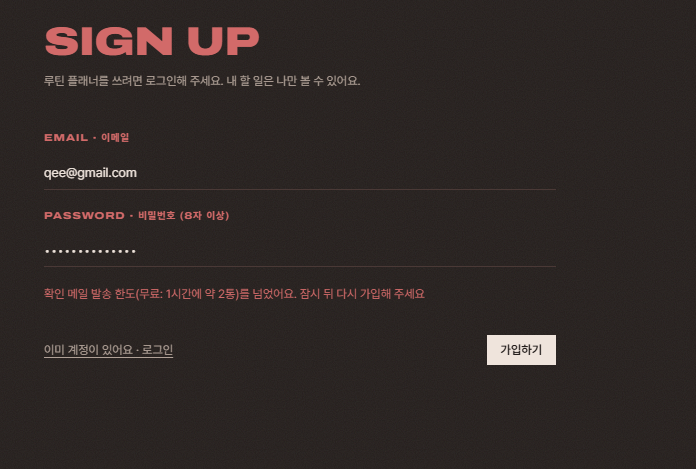
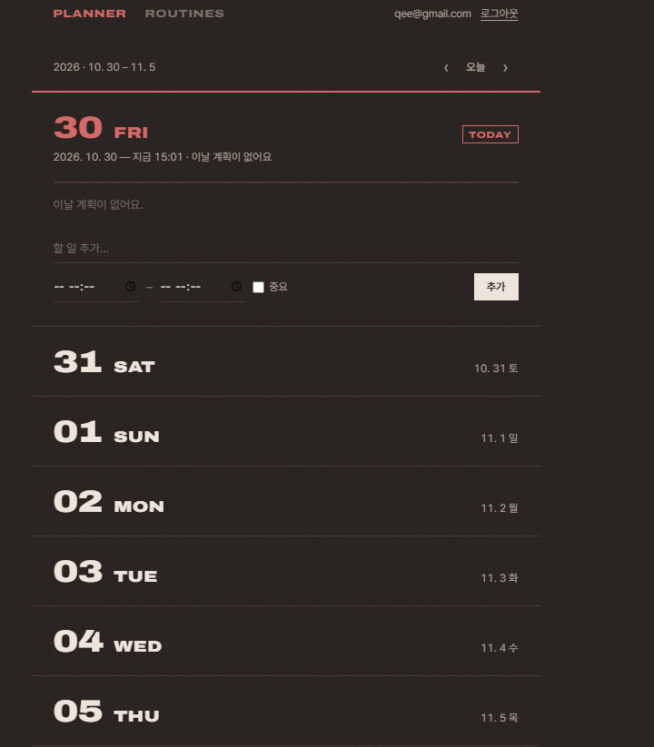

# AIFFEL Campus Agent Code Review Templete
- 개발자 : k-im-rose
- 리뷰어 : castlegyun

> 리뷰 범위: `todo-app/`의 서버, Supabase 스키마와 RLS, 화면 코드, README의 기록. 같은 저장소의 게임(`nyangi-ramen-shop/`)은 제외했다.
> 리뷰 방법: 코드와 문서를 읽고, 배포된 사이트에서 가입 화면을 실행해 보았다. 의심 가는 4곳은 같은 로직을 Node로 따로 실행해 확인했다.

# ART(Agent Review Template)
[O]  **1. 원하는 기능이 의도한 대로 동작하나요?**
- 요청(프롬프트)한 기능이 정상적으로 구현되었는지?
- 실제 실행 화면/결과물을 캡처하여 근거로 첨부

PRD의 기능이 모두 구현되어 있다. 기본 CRUD에 더해 루틴 자동 생성, '이 날만 빼기'(`skipped`), 상태 4종(완료·일부만·못 함·미기록), 회고와 '지난번 다짐', 반복 종료가 있다. 로컬(SQLite)과 Supabase 두 모드를 저장소 인터페이스 하나로 전환하는 구조가 깔끔하다.

근거가 충분하다. 화면 캡처 6장(로그인, 플래너, 추가, 회고, 루틴, RLS)이 있다. 자동 테스트 10개가 PRD 확인표와 1:1로 대응하고 모두 통과했다([`docs/test-result.txt`](docs/test-result.txt)). 배포 주소도 있다.

**리뷰어 실행 화면:** 배포된 사이트([aiffel-todo-app.onrender.com](https://aiffel-todo-app.onrender.com))에서 직접 실행했다.
- **가입 화면(첫 번째):** 무료 메일 발송 한도를 넘었을 때 "확인 메일 발송 한도(무료: 1시간에 약 2통)를 넘었어요"라는 원인별 안내가 표시되었다. 디버깅 기록에 적힌 수정(가입 실패 원인별 안내)이 배포 환경에서도 동작함을 확인했다.
- **플래너 화면(두 번째):** 로그인하면 상단에 내 이메일과 로그아웃 버튼이 보이고, 오늘(10. 30 FRI)부터 7일이 날짜·요일 형식으로 쌓인다. 오늘은 `TODAY` 표시와 함께 펼쳐져 있고, 현재 시각(15:01)과 할 일 추가 입력칸(시작·종료 시간, 중요 표시)이 보인다. 새 계정이라 다른 사람의 할 일 없이 "이날 계획이 없어요"만 표시되어, 계정별로 데이터가 분리되어 있음도 함께 확인된다. README 설명과 화면 캡처대로 동작한다.

사용자의 실제 고민("루틴대로 안 한다")에서 기능을 끌어낸 점이 좋다. 단순 Todo를 넘어 목적이 분명한 앱이다.

다만 테스트 결과 파일은 로컬(SQLite) 모드 기준이다. Supabase 모드의 기능 확인은 캡처와 RLS 기록으로만 되어 있다.

[O]  **2. 보안 검토를 수행했나요?**
- API 키, 비밀번호 등 민감 정보가 코드에 하드코딩되지 않았는지
- 사용자 입력값 검증 등 기본 보안 사항 확인
- 외부 데이터/의존성 사용 시 출처와 위험 검토했는지

- **민감 정보:** 코드와 Git 이력 전체에서 키 패턴을 검색했고 나오지 않았다. `.env`는 `.gitignore`에 있고, `service_role` 키를 쓰지 않는다.
- **입력값 검증:** 제목, 날짜, 시간, 상태, 요일, 회고 길이를 서버에서 검사하고 DB `check` 제약으로 한 번 더 막는다. XSS를 막으려고 `innerHTML`을 쓰지 않는다(`grep`으로 0건 확인).
- **잘한 점:** 이 수준의 과제에서 보기 드물 만큼 꼼꼼하다.
  - httpOnly 쿠키와 SameSite=Lax 사용
  - Origin 검사로 CSRF 방어
  - CSP를 포함한 보안 헤더
  - 로컬 실행 시 DNS rebinding 방어(Host 검사)
  - 로그인 실패 메시지로 가입 여부가 드러나지 않게 처리
  - RLS가 **연결 대상의 소유권**(남의 루틴에 할 일 연결, 남의 할 일에 회고 작성)까지 검사
  - `day_todos` 함수를 `security invoker`로 만들어 RLS 유지
  - `rls-test.sql`이 끝에 일부러 예외를 내서 시험 중 바뀐 데이터를 모두 되돌림
- **외부 의존성:** 외부 리소스는 글꼴(Google Fonts, jsDelivr 버전 고정)뿐이고 외부 스크립트는 없다. `npm audit` 결과도 기록되어 있다.
- 남은 한계(요청 횟수 제한 없음, `unsafe-inline`)를 스스로 적어 둔 점도 좋다. 다만 아래 개선 제안 6번처럼 일부 내용은 배포 이후 상황과 맞지 않는다.

[O]  **3. 에러가 난 부분을 디버깅하여 "문제를 해결한 기록"을 남겼나요?**
- 에이전트가 만든 코드의 오류를 어떻게 발견하고 수정했는지
- 새로운 시도 및 추가 실험이 기록되어 있는지

README의 디버깅 기록에 16건이 "증상 → 원인 → 해결" 표로 정리되어 있다. `form.title`이 폼 속성을 반환하던 문제, 깨진 JSON에서 내부 경로가 노출되던 문제, 메일 발송 한도(429) 등이다.

원인을 추측하지 않고 확인한 기록이 특히 좋다. Supabase 인증 로그에서 `429 over_email_send_rate_limit`를 확인했고, `email_confirmed_at`을 SQL로 조회했다. 이 429 문제를 고친 결과는 위 1번의 리뷰어 실행 화면에서 실제로 확인했다.

'코드 문제가 아니라 테스트 순서 문제'였던 경우도 정직하게 남겼다. 고친 뒤에는 같은 문제를 자동 테스트에 추가해 재발을 막았다.

새로운 시도와 실험도 날짜별 개발 기록과 "내 수정 요청 23건" 표에 남아 있다(디자인 1·2차, 외부 PRD 리뷰 반영, 이메일 확인을 잠시 껐다가 다시 켠 일 등).

# 참고 링크 및 코드 개선

## 1.리뷰 시 참고한 링크가 있다면 링크와 간략한 설명을 첨부합니다.

아래는 지적 내용의 근거가 되는 공식 문서다. 리뷰 중에 직접 열어 보지는 않았다.

- [Supabase: Row Level Security](https://supabase.com/docs/guides/database/postgres/row-level-security): RLS 정책과 `(select auth.uid())` 최적화 문법. 스키마가 이 권장 방식대로 작성되어 있다.
- [MDN: Date.parse()](https://developer.mozilla.org/en-US/docs/Web/JavaScript/Reference/Global_Objects/Date/parse): 존재하지 않는 날짜도 NaN이 아닌 값으로 파싱될 수 있다. 개선 제안 1번의 근거다.
- [MDN: decodeURIComponent()](https://developer.mozilla.org/en-US/docs/Web/JavaScript/Reference/Global_Objects/decodeURIComponent): 잘못된 `%` 인코딩이면 `URIError`를 던진다. 개선 제안 2번의 근거다.
- [OWASP: CSRF Prevention Cheat Sheet](https://cheatsheetseries.owasp.org/cheatsheets/Cross-Site_Request_Forgery_Prevention_Cheat_Sheet.html): Origin 검사, SameSite 쿠키, 그리고 GET 요청은 상태를 바꾸지 않아야 한다는 원칙. 개선 제안 3·5번의 근거다.

## 2.리뷰를 통해 개선을 제안할 부분이 있다면 내용과 간략한 설명을 첨부합니다.

1~4번은 Node로 같은 로직을 따로 실행해서 **확인한** 것이다. 5·6번은 코드를 읽고 판단한 것이라 **추정**이다.

| # | 위치 | 내용 | 영향 | 제안 |
|---|---|---|---|---|
| 1 | `server/index.js:80` `cleanDate` | `2026-02-30`, `2026-02-31`이 검증을 통과한다(확인함: `true`). | Supabase 모드에서는 Postgres가 거부해서 400 대신 **500 "서버에서 문제가 생겼어요"**가 나온다. 로컬 모드에서는 존재하지 않는 날짜가 그대로 저장된다. | 파싱한 연·월·일을 다시 문자열로 만들어 입력과 같은지 비교한다. |
| 2 | `server/auth.js` `readCookies` | 쿠키 값의 `%` 인코딩이 깨져 있으면 `decodeURIComponent`가 `URIError`를 던진다(확인함). | 그 브라우저에서는 모든 `/api` 요청이 500이 되고, 쿠키를 지우기 전까지 앱을 쓸 수 없다. localhost는 포트가 달라도 쿠키를 공유하므로, 다른 로컬 앱이 만든 쿠키가 원인이 될 수 있다. | `try/catch`로 감싸고, 깨진 쿠키는 건너뛴다. |
| 3 | `server/index.js:123` CSRF 검사 | 요청 헤더가 `Origin: null`이면(샌드박스 iframe 등) `new URL('null')`이 `TypeError`를 던진다(확인함). | 요청은 여전히 거부되므로 보안 문제는 아니다. 다만 403 대신 500이 나고 서버 로그에 오류가 남는다. | `try/catch`로 감싸고, 파싱에 실패하면 403을 돌려준다. |
| 4 | `server/index.js:105` `cleanDays` | `[1.5, 2]`가 `"1.5,2"`로 통과한다(확인함). 정수인지 검사하지 않는다. | Supabase 모드에서는 DB 정규식이 거부해서 500이 나고, 로컬 모드에서는 저장된다. | 필터에 `Number.isInteger(n)` 조건을 추가한다. |
| 5 | `GET /api/days/:date`와 `day_todos` 함수 (추정) | **GET 요청이 DB에 행을 만든다**(루틴 자동 생성). CSRF 검사는 GET을 통과시키고, SameSite=Lax 쿠키는 다른 사이트에서 링크로 이동할 때도 전송된다. | 다른 사이트가 사용자를 `/api/days/2099-01-01`로 보내면 그 날짜에 루틴 항목이 생긴다. 날짜 범위 제한도 없어서 아무 날짜에나 행이 쌓일 수 있다. 피해는 작지만 "GET은 상태를 바꾸지 않는다" 원칙에 어긋난다. | 조회할 수 있는 날짜를 오늘 기준 ±1년 정도로 제한한다. 근본적으로는 생성을 POST로 분리한다. |
| 6 | `server/auth.js` `resolveUser`와 README 보안 표 (추정) | ① Supabase와의 통신이 잠깐 실패해도 `getUser`와 `refreshSession`이 모두 오류를 내고, `clearSession`이 실행되어 **로그아웃된다**. ② README 보안 표 일부가 배포 이전 기준으로 남아 있다. `.env.example`에는 `PORT`와 `HOST`만 있다고 적혀 있고, 의존성 목록에 `@supabase/supabase-js`가 없다. "요청 횟수 제한 없음(로컬 전용이라 보류)"이라고 적혀 있지만 지금은 공개 배포 중이다. | ① 네트워크 장애 때마다 사용자가 다시 로그인해야 한다. ② 문서와 실제가 다르다. | ① 인증 실패(401 계열)일 때만 쿠키를 지우고, 네트워크 오류일 때는 503을 돌려준다. ② 보안 표를 현재 상태에 맞게 갱신한다. |

1~4번은 공통 원인이 하나다. **서버 검증이 DB 제약보다 느슨해서**, DB가 거부할 값이 서버를 통과한 뒤 400 대신 500으로 끝난다. 서버 검증 규칙을 DB `check` 제약과 같은 수준으로 맞추면 한 번에 해결된다.

# 총평

기능, 보안, 기록 세 항목 모두 기준을 넉넉히 넘는다. 특히 보안이 강하다. RLS가 "자기 행만"에서 그치지 않고 연결 대상의 소유권까지 검사한다. RLS 시험 SQL이 끝에서 스스로 롤백하게 설계한 점은 실무 수준이다. 디버깅 기록도 원인을 로그와 DB 조회로 확인한 뒤 고쳤고, 고친 내용을 테스트로 고정했다. 에이전트와 일하는 방식의 모범 사례다. 에이전트가 하면 안 되는 일(계정 삭제, 비밀번호 입력)을 사용자가 직접 한 판단도 좋다.

개선할 점은 크지 않다. 서버 입력 검증을 DB 제약 수준으로 맞추면(개선 제안 1~4번) 경계값에서 500이 나는 문제가 없어진다. 여기에 GET 요청의 부작용(5번)과 네트워크 오류 시 로그아웃(6번)을 정리하면 완성도가 더 올라간다.
