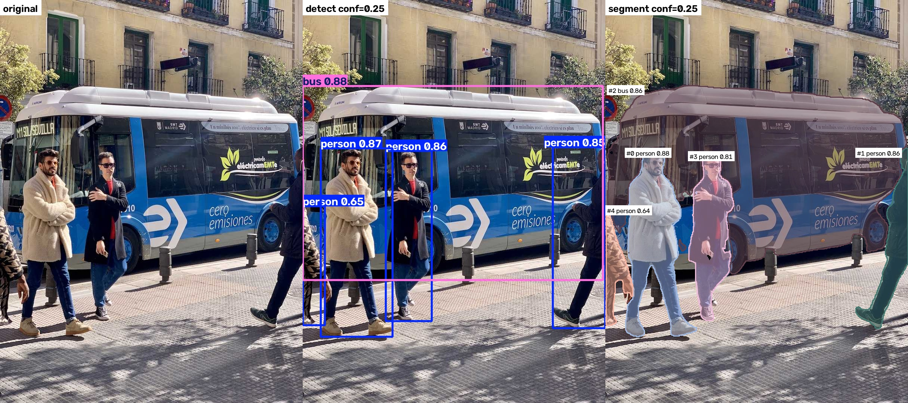
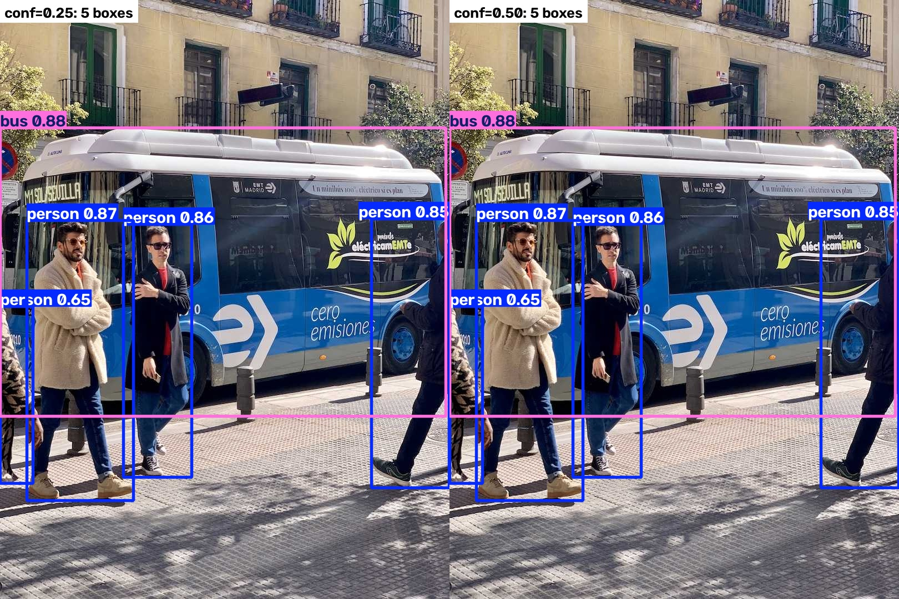
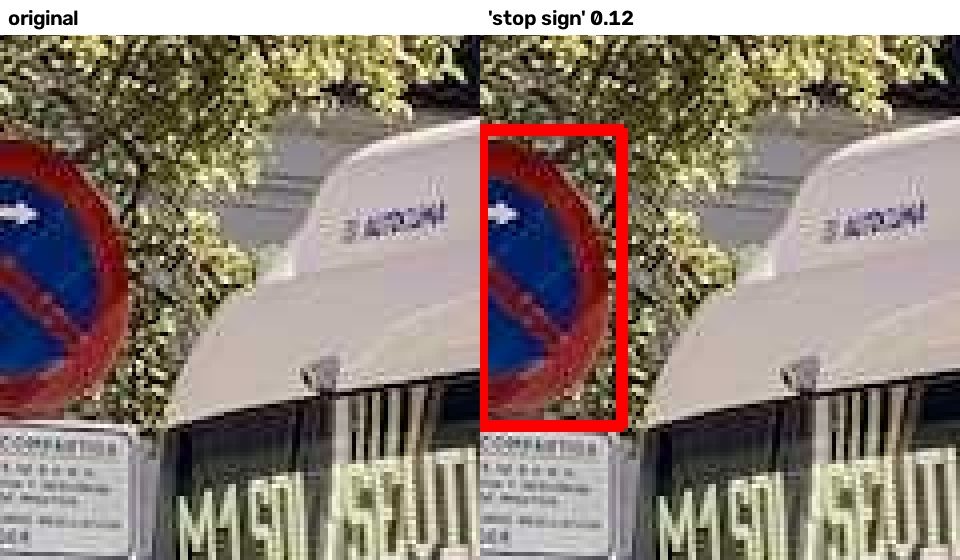
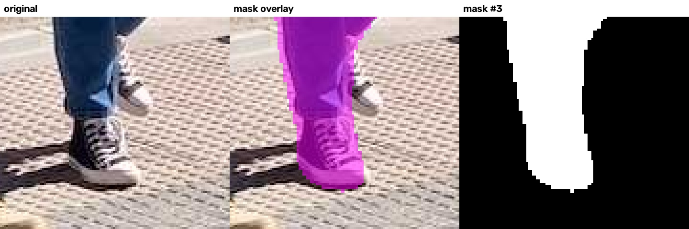
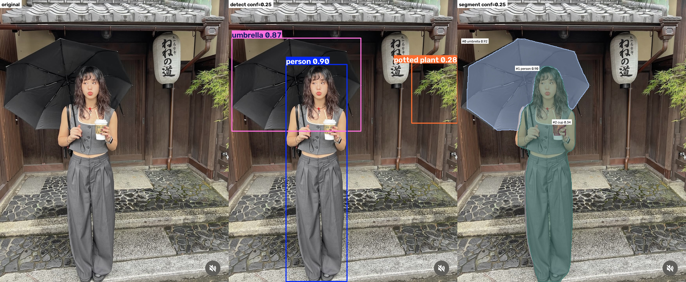
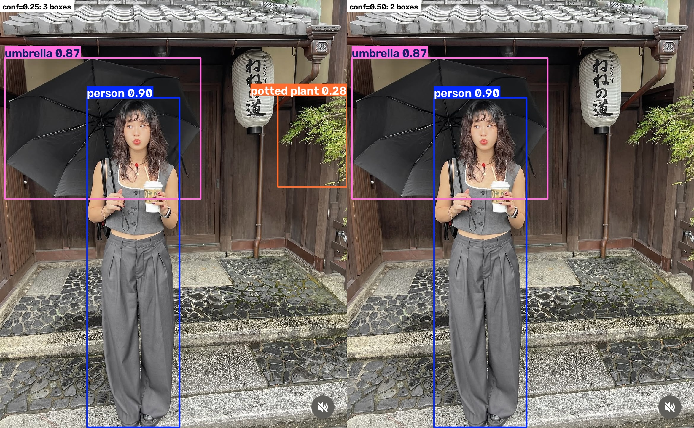
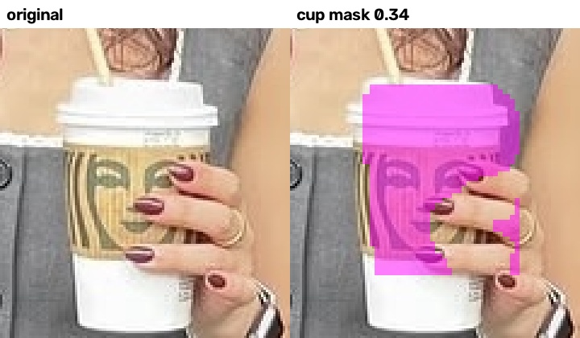
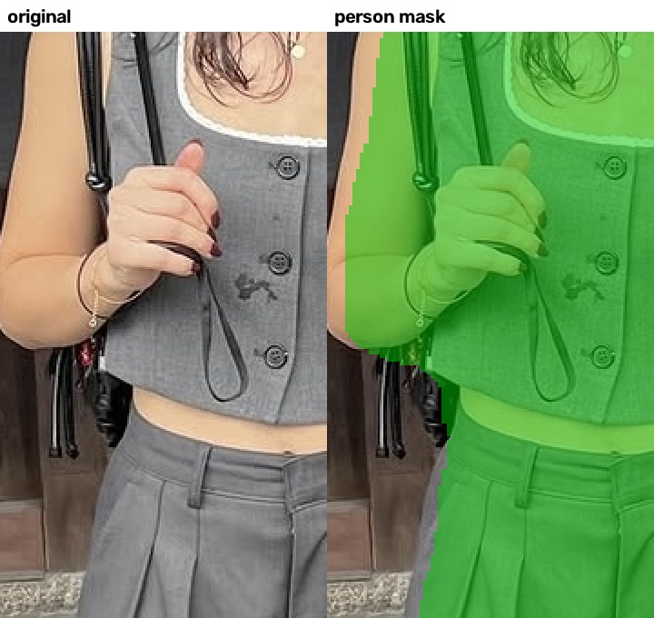

# A. YOLO 서비스 — 사진에서 어디를 찾았는가

사진 경로를 넣으면 detection 박스(`yolo26n.pt`)와 segmentation 마스크(`yolo26n-seg.pt`)를 그려 보여 주고, 결과 이미지·박스 좌표 JSON·마스크 PNG·실행 기록을 파일로 남기는 작은 명령줄 서비스입니다.

> **결과 해설 페이지:** [https://k-im-rose.github.io/aiffel/vision-03-04/A-yolo/explainer/](https://k-im-rose.github.io/aiffel/vision-03-04/A-yolo/explainer/)
> 이 README의 결과를 03-04 교안 개념(박스와 마스크, 임계값과 정밀도·재현율, 점수의 의미)과 연결한 해설입니다. 자기 사진의 후보 25개로 임계값을 직접 움직여 보는 실험도 있습니다. 페이지 파일은 [`explainer/`](explainer/)에 있습니다.

## 실행 방법

```bash
cd A-yolo
python3.12 -m venv .venv
source .venv/bin/activate
pip install -r requirements.txt

# 두 모델(yolo26n.pt, yolo26n-seg.pt)은 처음 실행할 때 이 폴더로 자동으로 내려받습니다
python yolo_service.py input/bus.jpg input/my_photo.jpg \
  --source-note "bus.jpg=Ultralytics 공식 예제 사진 https://ultralytics.com/images/bus.jpg" \
  --source-note "my_photo.jpg=제출자 본인이 나온 사진, 본인이 공개에 동의함. 원본의 메타데이터(EXIF)는 지운 사본"

# 원본 대조용 확대 이미지 (findings/)
python make_findings.py
```

옵션
- `--conf 0.25 0.50` 비교할 두 점수 임계값 (기본값이 이 두 값)
- `--classes person bus` 관찰할 클래스만 남기기 (생략하면 COCO 80개 전체)
- `--source-note 파일이름=설명` 입력 사진의 출처·공유 조건을 `manifest.json`에 남기기

## 저장되는 결과

| 경로 | 내용 |
|---|---|
| `outputs/yolo/<사진>/panel_conf0.25.jpg` | 원본 \| 박스 \| 마스크 나란히 |
| `outputs/yolo/<사진>/compare.jpg` | 임계값 0.25와 0.50의 박스 결과 나란히 |
| `outputs/yolo/<사진>/compare.json` | 0.50에서 사라진 박스, 0.25보다 낮은 후보(conf 0.05로 다시 예측) |
| `outputs/yolo/<사진>/conf0.25/det.json` | 박스마다 클래스·점수·좌표(`xyxy`, 원본 픽셀) |
| `outputs/yolo/<사진>/conf0.25/seg.json` | 마스크마다 클래스·점수·박스·면적·마스크 파일 이름 |
| `outputs/yolo/<사진>/conf0.25/masks/*.png` | 마스크 한 개당 흑백 PNG (원본 크기) |
| `outputs/yolo/manifest.json` | 입력 파일·해시, 모델·해시, 패키지 버전, 실행 위치, 설정, 실행 명령 |
| `outputs/yolo/code/yolo_service.py` | 이 실행에 쓴 코드 사본 |

`conf0.50/`에도 같은 파일이 있습니다.

## 실행 위치와 도구 선택 이유

- **어디서 실행했나:** 개인 컴퓨터(Apple M2, macOS 15.6.1)의 CPU에서 실행했습니다. 사진은 컴퓨터 밖으로 나가지 않습니다. 인터넷은 처음에 모델 파일과 예제 사진을 내려받을 때만 썼습니다.
- **왜 로컬·CPU인가:** 과제 조건이 `device=cpu`, `imgsz=640`입니다. 모델 두 개가 모두 nano 크기(파일 5~7MB)라서 GPU 없이도 사진 한 장을 1초 안팎에 처리합니다. 자기 사진을 외부 서버에 올리지 않아도 되는 것도 로컬을 고른 이유입니다.
- **왜 YOLO26n 두 개인가:** 박스만으로는 "어디까지가 사람인가"를 알 수 없어서, 같은 사진을 segmentation 모델에도 넣어 윤곽을 비교했습니다. 두 모델은 따로 예측하므로 점수와 번호가 조금씩 다릅니다. 예: 검은 재킷을 입은 사람은 detection에서 `#2 0.861`, segmentation에서 `#3 0.811`입니다.
- **웹 화면 대신 명령줄:** 과제의 핵심인 박스·마스크·JSON·manifest 저장을 먼저 완성했습니다. 업로드 폼과 임계값 슬라이더는 만들지 않았습니다.

## 결과 1 — 버스 예제 사진



conf 0.25에서 박스 5개(bus 1, person 4)와 마스크 5개가 나왔습니다.

**JSON과 화면 연결하기:** `det.json`의 `#0 bus 0.8806 [0.0, 230.5, 803.1, 750.5]`는 화면의 분홍 박스입니다. x가 0에서 803까지라서 사진 가로(810px)의 거의 전부를 차지합니다. 실제로 버스는 사진 양쪽 끝에서 잘려 있습니다.

### 임계값 0.25 → 0.50: 사라진 박스 없음



- 두 임계값의 박스가 5개로 똑같습니다(`compare.json`의 `dropped_at_high: []`). 남은 박스 중 가장 낮은 점수는 0.654(왼쪽 끝에서 잘린 사람)라서 두 임계값 모두를 넘습니다.
- **0.25와 0.50 사이에는 후보가 하나도 없었습니다.** conf 0.05로 다시 예측해 보니 0.25보다 낮은 후보가 4개 있었고, 4개 모두 오탐입니다.

| 후보 | 점수 | 원본과 대조한 결과 |
|---|---|---|
| stop sign | 0.124 | 왼쪽 끝의 빨강·파랑 원형 **주차 금지** 표지판입니다. 정지 표지판(STOP)이 아닙니다. COCO 클래스에 이 표지판이 없어서 가장 비슷한 클래스로 잘못 붙은 것으로 보입니다. |
| handbag | 0.077 | 왼쪽 끝에서 잘린 사람의 늘어뜨린 손(x 43~78, y 731~812)입니다. 확대해 보니 맨손이고 가방은 보이지 않습니다. |
| skateboard | 0.070 | 오른쪽 사람의 발밑(x 669~808, y 822~881)입니다. 원본에는 운동화와 보도블록만 있고 스케이트보드는 없습니다. |
| handbag | 0.056 | 검은 재킷을 입은 사람이 휴대폰을 쥔 손과 검은 코트 자락(x 226~291, y 634~705)입니다. 손에 든 작은 물건을 가방으로 본 것 같습니다. |



정리하면, 이 사진에서 임계값을 0.25에서 0.50으로 올려도 결과는 같습니다. 0.25 아래로 내리면 위의 오탐이 보이기 시작합니다.

### 마스크가 빠뜨린 곳: 검은 재킷 입은 사람의 뒷발



segmentation `#3 person 0.81`(검은 재킷)을 원본 x 220~340, y 760~880 범위에서 4배로 확대했습니다. 앞발의 검은 운동화는 마스크(보라색)에 들어갔지만, **뒤로 든 흰 운동화(대략 x 285~300, y 800~820)는 마스크 밖**입니다. 박스(`det.json #2`, y 404.8~860.9)는 이 발까지 감싸므로, "박스 안에는 있지만 윤곽에서는 빠진" 부분입니다.

같은 사람의 손에 든 휴대폰도 마스크에 구멍으로 남았습니다(전체 마스크 이미지에서 손 부분의 검은 점). 휴대폰은 사람이 아니니 틀렸다고 보기는 어렵지만, "사람 영역"을 그대로 잘라 쓰면 손 일부가 함께 빠집니다.

## 결과 2 — 자기 사진 (`input/my_photo.jpg`)

제출자 본인이 우산과 커피 컵을 들고 서 있는 전신 사진입니다(1170×1446). 본인이 공개에 동의했고, 원본의 메타데이터(EXIF)는 지운 사본을 넣었습니다. 오른쪽 아래의 음소거 아이콘은 원본 이미지에 처음부터 들어 있던 것입니다. 영상 화면을 캡처한 흔적으로 보이며 실제 물체가 아닙니다. YOLO도 이 아이콘을 아무것으로도 탐지하지 않았습니다.

**고른 이유:** 같은 날 받은 사진 두 장 중 이 사진을 골랐습니다. 다른 사진(휴대폰과 꽃을 든 사진)은 conf 0.25에서 박스 2개(person, cell phone), 마스크 1개만 나왔고, 0.50으로 올려도 사라지는 박스가 없었습니다. 이 사진은 들고 있는 물건(우산·컵)과 배경 물체가 더 많아 임계값과 마스크를 비교할 거리가 있습니다.



| 모델 | conf 0.25 결과 | conf 0.50 결과 |
|---|---|---|
| detection | person 0.905, umbrella 0.868, potted plant 0.281 | person, umbrella |
| segmentation | umbrella 0.918, person 0.902, cup 0.337 | umbrella, person |

### 임계값 0.25 → 0.50: 사라진 박스 2개



- **potted plant 0.281** (오른쪽 위, x 936~1170, y 323~631)은 0.50에서 사라집니다. 원본에서 이 자리는 화분이 아니라 담장 너머로 늘어진 **나뭇가지(단풍나무 잎)**입니다. COCO 클래스에 '나무'가 없어서, 가장 가까운 'potted plant'로 낮은 점수를 붙인 것으로 보입니다. 이 경우에는 0.50이 오탐 하나를 걸러 낸 셈입니다.
- **cup**은 반대 경우입니다. 실제로 손에 컵을 들고 있지만 0.50에서는 두 모델 모두 컵을 찾지 못합니다.
  - segmentation은 conf 0.25에서 cup을 0.337로 찾았습니다.
  - detection은 conf 0.25에서도 컵을 놓쳤습니다. conf 0.05로 다시 돌려야 cup 0.180(x 485~549, y 612~702)이 나옵니다. 위치는 segmentation의 cup 박스(x 485~553, y 612~693)와 거의 같습니다.
  - 정리하면 0.50은 이 사진에서 오탐 하나(나뭇가지)를 지우는 대신 실제 물체 하나(컵)를 놓칩니다. 0.25로 내려도 detection 모델은 컵을 놓칩니다.

### 마스크 대조 1 — 컵의 아래쪽이 빠졌다



cup 마스크(보라색)는 흰 뚜껑과 컵 홀더(로고가 있는 종이 띠)는 덮었습니다. 하지만 **홀더 아래의 흰 컵 몸통은 마스크 밖**입니다. 반대로 컵을 쥔 손가락 일부는 마스크 안에 들어갔습니다. `seg.json`의 `mask_fill_of_box`가 0.677이라 박스의 약 3분의 2만 컵으로 칠해졌습니다.

### 마스크 대조 2 — 놓친 대상: 어깨에 멘 검은 가방



왼쪽 어깨에 검은 가방을 메고 있습니다. 끈은 어깨에서 내려오고, 가방 몸통은 왼쪽 허리 뒤에 일부만 보입니다. 두 모델 모두 conf 0.25에서 handbag·backpack을 찾지 못했고, detection을 conf 0.05로 다시 돌린 후보에도 없습니다. person 마스크(초록색)는 어깨끈을 사람의 일부로 덮었지만, 허리 뒤로 삐져나온 가방 몸통은 마스크 밖에 남았습니다. 가방 대부분이 팔과 몸에 가려져 있고 배경의 어두운 나무 문과 색이 비슷해서 놓친 것으로 보입니다.

**버스 사진과 비교:** 버스 사진은 모든 박스가 0.65 이상이라 임계값을 바꿔도 결과가 같았습니다. 자기 사진에서는 0.25와 0.50 사이에 후보 두 개(나뭇가지, 컵)가 있어서, 임계값에 따라 결과가 실제로 달라졌습니다. 사진을 바꿔도 코드를 고치지 않고 같은 폴더 구조로 결과가 저장되는 것도 확인했습니다.

## 범위와 한계 (확인하지 못한 것)

- 사진 두 장으로 확인한 결과입니다. 모델 성능 전체를 평가한 것이 아닙니다.
- 자기 사진은 원본에서 메타데이터만 지우려고 JPEG(품질 95)로 다시 저장했습니다. 이 과정에서 점수가 소수점 둘째 자리 정도 달라졌습니다. 예: 원본 파일로 시험했을 때 segmentation의 potted plant가 0.254로 0.25를 겨우 넘었지만, 다시 저장한 사본에서는 0.25 아래로 내려가 빠졌습니다. 표의 숫자는 모두 제출한 사본 기준입니다.
- 오탐·미탐은 화면으로 확인할 수 있는 것만 적었습니다. 정답 라벨이 없어서 놓친 대상이 정말 하나도 없는지는 장담할 수 없습니다. 버스 사진의 볼라드(보도의 기둥)는 COCO 클래스에 없어서 탐지 대상이 아닙니다.
- 0.25 아래 후보 4개를 오탐으로 본 근거는 사진 확대 대조뿐입니다. 사진은 200% 이상 확대하면 흐려지므로, 작은 물건은 잘못 읽었을 수 있습니다.
- `manifest.json`의 `run_at`은 UTC 시각입니다.

## 라이선스

Ultralytics YOLO 코드와 가중치는 AGPL-3.0입니다. 이 결과물은 과제 제출용으로만 쓰고 서비스로 배포하지 않습니다. 배포한다면 AGPL-3.0 또는 Enterprise 라이선스 조건을 따로 확인해야 합니다.
