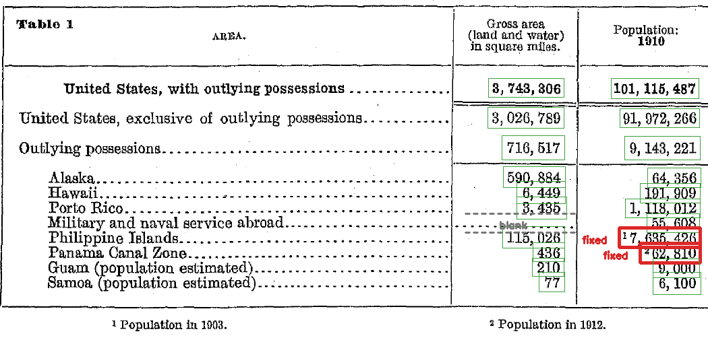

# B. OCR로 표 이미지를 다시 쓰기 (추가 과제)

> 이 폴더는 추가로 해 본 과제입니다. **채점 대상은 [A. YOLO 서비스](../A-yolo/)입니다.**

과제에서 제공한 표 이미지 두 장 중 **Census Table 1**(1910년 미국 인구조사의 면적과 인구)을 골랐습니다. PaddleOCR로 글자를 읽고, 글자 영역의 좌표로 행과 열을 연결해 [`table.csv`](outputs/ocr/table.csv)와 [`document.md`](outputs/ocr/document.md)를 만들었습니다. 그다음 원본과 대조해 고친 칸을 기록했습니다.

> **결과 해설 페이지:** [https://k-im-rose.github.io/aiffel/vision-03-04/B-ocr/explainer/](https://k-im-rose.github.io/aiffel/vision-03-04/B-ocr/explainer/)
> 이 README의 결과를 03-04 교안 개념(OCR의 네 작업과 오류 전파, 점수와 검토 기준, 합계 검산, 원시 결과와 수정의 분리)과 연결한 해설입니다. 표 위의 글자 영역 41개를 눌러 OCR이 읽은 값과 점수를 보고, 검토 기준 점수를 직접 움직여 보는 실험도 있습니다. 페이지 파일은 [`explainer/`](explainer/)에 있습니다.

## 실행 방법

```bash
cd B-ocr
python3.12 -m venv .venv
source .venv/bin/activate
pip install -r requirements.txt

# OCR 모델(PP-OCRv6_medium det/rec)은 처음 실행할 때 ~/.paddlex/ 아래로 자동으로 내려받습니다
python ocr_table.py
```

`review.json`은 사람이 원본과 대조해 적은 수정 내역입니다. 스크립트는 OCR 결과를 자동으로 고치지 않습니다. `review.json`에 적힌 칸만 고치고, 이번 OCR이 읽은 원시값이 `review.json`에 적힌 원시값과 다르면 멈춥니다.

## 저장되는 결과 (`outputs/ocr/`)

| 파일 | 내용 |
|---|---|
| `census-table.png` | 입력 표 이미지 사본 |
| `raw_ocr.json` | PaddleOCR 원시 결과 (글자 영역 다각형, 문자열, 점수) |
| `ocr_lines.csv` | 글자 영역마다 문자열·점수·좌표 (x1, y1, x2, y2) |
| `ocr_regions.png` | PaddleOCR이 찾은 글자 영역 시각화 |
| `table.csv` | 행·열을 연결한 표. 숫자는 쉼표 없이 저장, 각주와 검토 상태 열 포함 |
| `document.md` | 출처, 표, 각주, 검토 기록(고친 칸·값 없는 칸·합계 검산·확인 필요) |
| `review_marks.png` | 원본 위에 칸 상태 표시: 초록 = 그대로 맞음, 빨강 = 고친 칸, 회색 점선 = 값 없음 |
| `manifest.json` | 출처, 원문 페이지, 입력 파일·해시, 모델·패키지 버전, 실행 위치와 설정 |

## 실행 위치와 도구 선택 이유

- **어디서 실행했나:** A와 같은 개인 컴퓨터(Apple M2, macOS)의 CPU에서 실행했습니다. 처음에 OCR 모델을 내려받을 때만 인터넷을 썼고, 표 이미지는 컴퓨터 밖으로 보내지 않았습니다.
- **왜 로컬인가:** PaddlePaddle이 맥(arm64) CPU에 설치되었고, 표 한 장(1050×505)은 GPU 없이도 수십 초 안에 처리됩니다. 설치가 막혔다면 교안 안내대로 코랩으로 옮기려고 했지만 그럴 필요가 없었습니다.
- **왜 Census Table 1인가:** 칸이 22개라 모든 값을 하나하나 원본과 대조할 수 있습니다. 하위 지역의 합이 위쪽 합계와 맞아야 하는 표라서, 계산으로 OCR 오류를 찾는 검산도 할 수 있습니다.
- **표 구조는 왜 직접 연결했나:** 이 표는 열이 3개뿐이고 세로 괘선 위치가 분명해서, 글자 영역의 x 좌표(670, 860)로 열을 나누고 y 중심으로 행을 묶는 것으로 충분했습니다. 별도 표 구조 인식 모델은 쓰지 않았습니다.

## 결과



### OCR이 틀린 곳 2칸: 각주 번호를 숫자에 붙여 읽음

| 행 | 원본 | OCR 원시 인식 | OCR 점수 |
|---|---|---|---:|
| Philippine Islands (인구) | ¹7,635,426 | `17,635,426` | 0.989 |
| Panama Canal Zone (인구) | ²62,810 | `262,810` | 0.945 |

두 칸 모두 숫자 앞의 **작은 위첨자 각주 번호**(¹ = 1903년 인구, ² = 1912년 인구)를 숫자의 일부로 읽었습니다. 필리핀 인구는 원래 값의 2배가 넘게 됩니다. 그런데도 OCR 점수는 0.989로 높았습니다. **점수만 보고는 이 오류를 찾을 수 없었습니다.**

### 계산으로 오류 찾기 (합계 검산)

이 표는 하위 지역 8곳의 합이 `Outlying possessions` 값과 같아야 합니다. OCR 값을 그대로 더하면 인구 합계가 맞지 않습니다.

| 검산 | OCR 원시값으로 | 고친 뒤 | 표에 적힌 값 |
|---|---:|---:|---:|
| 인구: 하위 지역 8곳의 합 | 19,343,221 ✗ | 9,143,221 | 9,143,221 |
| 면적: 하위 지역 8곳의 합 | 716,517 | 716,517 | 716,517 |
| 인구: 본토 + 해외 = 전체 | – | 101,115,487 | 101,115,487 |
| 면적: 본토 + 해외 = 전체 | – | 3,743,306 | 3,743,306 |

인구 합계 차이는 정확히 10,200,000입니다. 필리핀 칸 앞에 붙은 1(10,000,000)과 파나마 칸 앞에 붙은 2(200,000)를 더한 값과 같습니다. 원본 확대로 찾은 두 오류를 검산이 따로 한 번 더 확인해 준 셈입니다. 반대로 원본을 보지 않았더라도, 이 검산이 틀린 칸이 있다는 신호를 줬을 것입니다. 다만 검산이 맞는다고 모든 칸이 맞는 것은 아니라서(교안: "계산이 맞는 값도 원본과 대조해야 검토가 마무리된다"), 나머지 칸도 모두 원본과 대조했습니다.

### 값이 없는 칸 1칸

`Military and naval service abroad`(해외 복무 군인)의 면적 칸은 원본에 숫자 없이 점선만 있습니다. OCR도 아무것도 읽지 않았습니다. 면적이 없는 항목이라 **0이 아니라 빈칸**으로 두었습니다(`table.csv`에서는 빈 값, `document.md`에서는 —).

### 그대로 맞은 것

나머지 숫자 19개는 원본과 일치했습니다. 원본은 `101, 115, 487`처럼 쉼표 뒤에 띄어쓰기가 있고 오래된 활자라 3이 8처럼 보이기도 합니다. 그래도 OCR은 숫자를 맞게 읽었습니다. 띄어쓰기는 들쭉날쭉하게 읽었지만(`101, 115, 487`, `3,743,306`) CSV에서는 쉼표와 공백을 빼고 숫자만 저장했습니다.

## 교안이 예로 든 오류와 실제 결과

- **교안의 예:** 숫자 0을 알파벳 O로 읽기(`12,34O`), 두 행이 한 줄에 붙기, 쉼표 때문에 CSV 열이 잘못 갈라지기.
- **이 표에서는:** 0↔O 혼동이나 행이 붙는 오류는 없었습니다. 쉼표 문제는 CSV에 숫자만 저장해서 피했습니다. 대신 교안에 없던 **각주 번호**가 오류를 만들었습니다. 사람 눈에는 작은 위첨자라 숫자와 구별되지만, OCR은 같은 줄의 글자로 이어 읽었습니다.

## 회고 — 과제를 하며 생긴 질문

### A(사진)와 B(표 글자)는 다른 것을 말하는가?

묻는 질문이 다릅니다. A는 "무슨 물체가 어디에 있나", B는 "무슨 글자가 쓰여 있고 표의 어느 칸에 있나"를 묻습니다. B에는 글자를 찾고 읽은 뒤 행·열 짝을 맞추는 레이아웃 분석 단계가 하나 더 있고, 결과가 그대로 데이터로 쓰이기 때문에 숫자 한 자리 오류의 무게가 더 큽니다. 실제로 각주 번호 하나 때문에 인구 합계가 천만 단위로 어긋났습니다.

결론은 같았습니다. 점수는 정답 여부가 아니고(A의 컵은 0.18인데 실제로 있었고, B의 필리핀 칸은 0.989인데 틀렸음), 모델 결과는 후보이며 사람이 원본과 대조해 확정해야 합니다.

### 임계값, 오탐, 미탐은 B에도 해당되는가?

해당되지만 찾는 대상이 다릅니다. A의 임계값은 "이 점수 이상인 상자만 남기는" 기준이라 오탐은 없는 물체를 있다고 한 것, 미탐은 있는 물체를 놓친 것입니다. B에서 쓴 임계값은 "이 점수 미만인 칸만 사람이 검토하는" 기준이라, 찾는 대상이 물체가 아니라 **틀린 칸**입니다.

- 오탐: 맞게 읽은 칸이 검토 대상으로 걸림 → 시간만 듭니다.
- 미탐: 틀린 칸이 점수가 높아 그냥 통과함 → 틀린 숫자가 표에 남습니다.

검토 기준을 0.97로 두면 3칸이 걸려 파나마 칸은 잡지만 필리핀 칸(0.989)은 통과합니다. 0.99로 올려야 두 오류를 다 잡고, 맞게 읽은 칸 2개도 함께 봐야 합니다. 기준을 어디에 두든 한쪽 실수를 줄이면 다른 쪽이 늘어난다는 점은 A와 같았습니다. B에서는 미탐이 더 아픈 실수라서 점수 기준에만 기대지 않고, 22칸 전체 원본 대조와 합계 검산을 함께 했습니다.

## 범위와 한계

- 표 한 장(Census Table 1)만 처리했습니다. FRASER No. 11은 하지 않았습니다.
- 행·열 연결은 이 표의 괘선 위치에 맞춘 규칙(x 670, 860 경계)입니다. 다른 표에는 그대로 쓸 수 없습니다.
- 들여쓰기(하위 지역 여부)도 글자 시작 x 좌표로 정한 규칙입니다.
- 칸 22개(숫자 21개, 빈칸 1개)를 모두 원본 확대 이미지와 대조했고, 남은 '확인 필요' 칸은 없습니다.
- 필리핀(1903년)과 파나마 운하 지대(1912년)의 인구는 1910년 값이 아닌데, 원본 표의 1910년 합계에 그대로 더해져 있습니다. 이 표를 쓸 때는 기준 연도가 다르다는 점을 함께 적어야 합니다.
- 'Porto Rico'는 1910년 당시 표기라 그대로 두었습니다.

## 입력 자료의 출처

미국 인구조사국, 1910년 인구조사 보고서(1913년 발행), PDF 2쪽·인쇄 22쪽의 Table 1. 미국 연방정부 발행 자료로 퍼블릭 도메인입니다. 표 이미지는 과제에서 제공한 것(200 dpi 추출)을 그대로 썼습니다.
